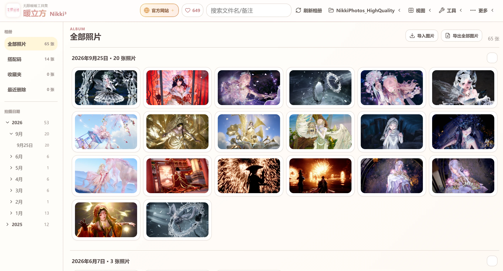
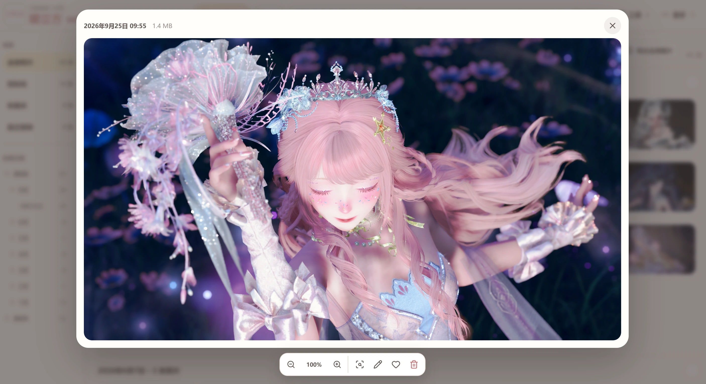
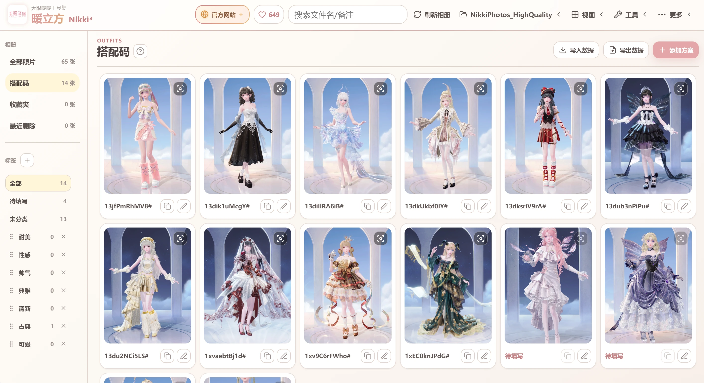
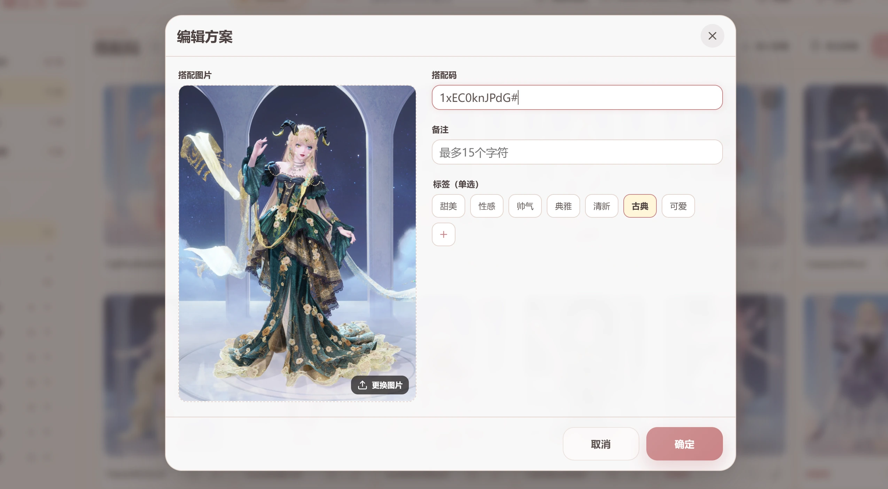
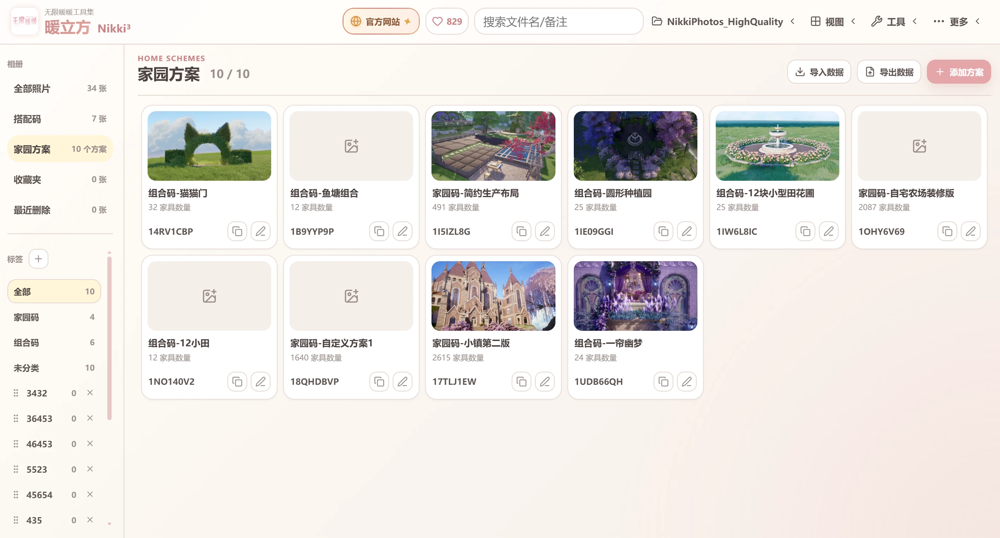
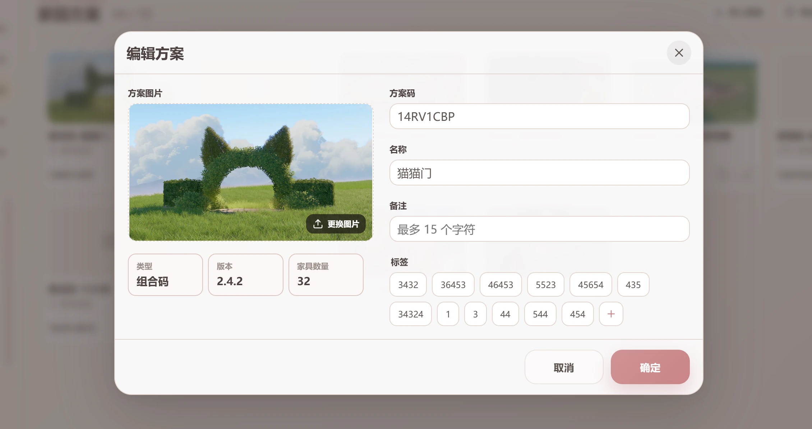
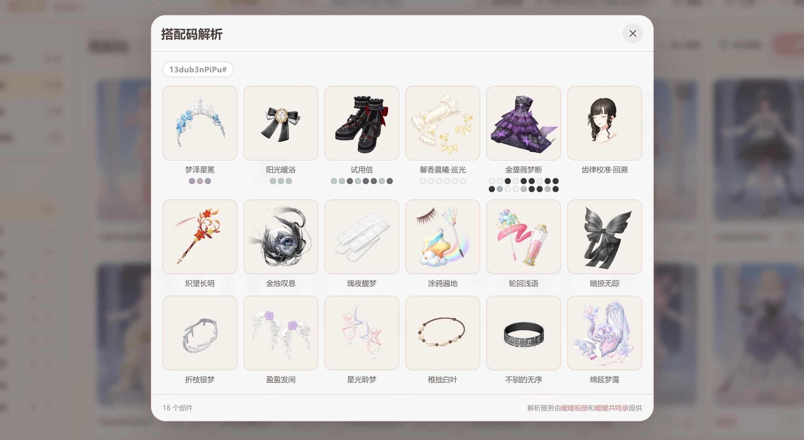
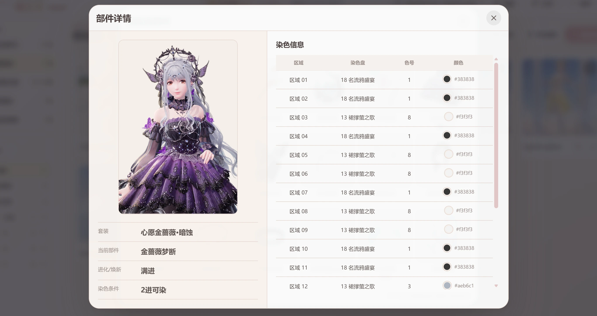
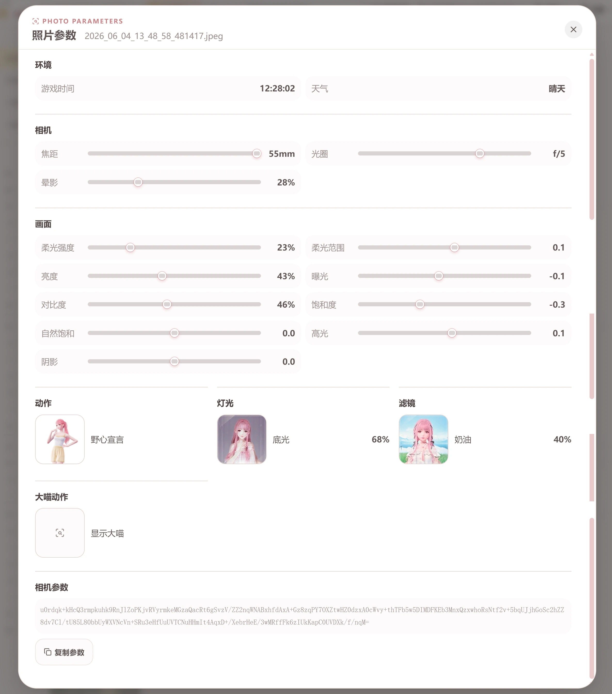

# 暖立方

<div align="center">
  
  <p><strong>Nikki³ · 无限暖暖工具集</strong></p>
  <p>暖立方（NikkiCube）在浏览器中整理相册、搭配码、家园方案、相机参数和共鸣记录，支持可选的共鸣云同步，并提供专项清理工具。</p>
  <p style="color: orange;">如果遇到问题，请及时在网站内问题反馈处填写问卷，或在 GitHub / Gitee 的 Issues 或作者社交平台反馈。</p>
  <p>
    <a href="https://github.com/sumopenny/Infinity-Nikki-Album-Manager/releases">GitHub Releases</a> ·
    <a href="https://gitee.com/sumopenny/Infinity-Nikki-Album-Manager/releases">Gitee Releases</a> ·
    <a href="https://github.com/sumopenny/Infinity-Nikki-Album-Manager">GitHub</a> ·
    <a href="https://gitee.com/sumopenny/Infinity-Nikki-Album-Manager">Gitee</a>
  </p>
  <p><a href="README_EN.md"><strong>English</strong></a></p>
</div>

---
### 官网：https://nikki3.pages.dev/

### 在线使用（工具集）：https://infinity-nikki-album-manager.pages.dev/

> 工具集 Vercel 备选地址（需要 VPN）：https://infinity-nikki-album-manager.vercel.app
>
> 本地部署运行时再下载压缩包或 clone 项目。点击跳转本地部署教程：[本地安装](#本地安装)

---
## 网站与界面

<div align="center">
  
  <p><sub>官网首页：站点介绍、功能一览与界面预览，从这里进入工具集</sub></p>
</div>

### 相册浏览

<div align="center">
  
  
  <p><sub>左 · 主界面：按“年份 &gt; 月份 &gt; 日期”折叠的照片时间轴 ｜ 右 · 大图查看：50%–300% 缩放、拖动与键盘翻页</sub></p>
</div>

### 搭配码

<div align="center">
  
  
  <p><sub>左 · 搭配码界面：方案列表、标签与待填写方案 ｜ 右 · 搭配码编辑窗口：添加图片、填写搭配码与选择标签</sub></p>
</div>

### 家园方案

<div align="center">
  
  
  <p><sub>左 · 家园方案界面：管理家园码、组合码、标签与方案列表 ｜ 右 · 家园方案编辑窗口：填写家园码、组合码与选择标签</sub></p>
</div>

### 解析与清理

<div align="center">
  
  
  <p><sub>左 · 搭配码解析：部件与妆容图鉴对照 ｜ 右 · 搭配码部件解析详情：套装、部件与染色信息</sub></p>
</div>

### 小工具

<div align="center">
  
  
  <p><sub>左 · 照片参数解析：拍摄时间、天气、焦距、光圈、普通动作、灯光与滤镜 ｜ 右 · 专项清理：低画质图片、崩溃快照、运行日志与游戏内置浏览器缓存</sub></p>
</div>

## 功能

### 相册浏览

按日期浏览照片，支持大图预览、收藏、备注搜索和批量导入导出。

### 搭配码与参数解析

管理搭配与家园方案，解析搭配码和照片参数，支持标签分类及 ZIP 备份。

### 个人衣橱

套装与单品卡片图片区统一使用 `img/back.png` 作为背景。电脑端套装卡片按最小宽度 160px 自动排列，间距 16px，内容区达到 1040px 时可显示六列；单品列表和手机端布局保持不变。

衣橱与共鸣记录共用「添加数据／清空本地记录／导出数据」按钮和导入窗口，包含相同的书签、控制台凭据教程；统一使用「添加数据」窗口，获取预览后同行显示「导入共鸣记录」「导入衣橱记录」，粘贴成功仅显示顶部提示。默认同时勾选，勾选框沿用日期选择按钮的圆角与选中样式；两处均仅在选中时显示勾，悬停只高亮边框。确认后仅整份替换勾选的模块，两个模块同时导入时统一提交；文件未包含的数据类型不可选，两项都取消时不能确认。清空衣橱需确认，不影响共鸣记录。衣橱界面不再显示本机保存提示及其附带时间，数据存储方式保持不变。

电脑端衣橱的套装／单品切换与筛选位于左侧全局导航下方，沿用侧栏样式与自定义下拉菜单并独立滚动，展开菜单不受侧栏裁切；两端共用顶栏搜索名称或 ID，手机使用顶栏搜索入口，页面不另设搜索框。切换套装／单品会重置全部筛选、排序和搜索关键词。

共鸣菜单新增「个人衣橱」：电脑从左侧共鸣子菜单进入，手机在共鸣页面切换「个人衣橱」。首版仅记录服装，提供套装／单品视图；原套、焕新和进化版本各占一张卡片，可按名称、ID、星级、版本、部位及拥有状态筛选；套装与单品详情仅展示部件和收集状态，不提供手动修改或批量管理。套装封面按素材的 448:656 比例完整展示，消除比例不匹配造成的侧边留白及图片底部基线空隙；单品图保持原样。

衣橱保存在当前浏览器本机，可独立导出／恢复 JSON。导入国服奇想手账或衣橱 JSON 时先显示预览，确认后覆盖整份衣橱；手账未返回的散件显示「未记录」，不等于游戏中未拥有。支持原始手账 JSON，不支持仅含共鸣记录的导出文件。首版不含妆容、云同步，衣橱已纳入「全部数据」ZIP，也可使用模块内的 JSON 备份；清除网站数据会一并清除衣橱。

桌面端共鸣筛选、拍摄动作排序与衣橱菜单共用独立浮层定位，阴影不受侧栏裁切；侧栏继续独立滚动，外层滚动或调整窗口时收起菜单。

### 共鸣记录

导入、查看和统计共鸣记录，支持 JSON 导入导出及账号云同步。

电脑布局（≥900px）保留左侧套装立绘，右侧上下同时展示第一套和第二套；每套的已记录抽数与已知部件均抽位于对应部件上方，窄窗口允许部件换行，无需切换套数。标题下仍显示两套合计的总抽数与平均抽数。

### 文件清理

清理低画质图片、游戏截图、崩溃快照、日志和缓存。

### 小工具与帮助

提供抽卡吉时、更新记录、使用帮助和问题反馈。

## 快速开始

官网入口：https://nikki3.pages.dev/ 。工具集直接打开 https://infinity-nikki-album-manager.pages.dev/ 即可使用，也可通过下载压缩包或 clone 项目来本地运行，点击跳转本地部署教程：[本地安装](#本地安装)。

> 如果国内直连地址临时不可用，可尝试 Vercel 备选地址（需要外网环境）：https://infinity-nikki-album-manager.vercel.app

## 手机使用

- 底部导航切换搭配码、家园方案、相机参数和共鸣记录；相册目录授权与文件清理需在电脑上使用。
- 顶部提供搜索、视图设置和“更多”；标签或星级入口用于筛选，“+”用于添加，“⋯”菜单提供导入导出等操作。
- 手机端四个模块没有数据时，在说明文字下展示对应使用截图，原空状态导入按钮移除，仍可从“⋯”菜单导入；搜索或筛选无结果时不展示截图，电脑端不变。截图素材依次放在 `img/page/outfits.webp`（搭配码）、`img/page/home.webp`（家园方案）、`img/page/camera.webp`（相机参数）、`img/page/resonance.webp`（共鸣记录）。图片完整等比显示，缺图或加载失败时隐藏；新增或替换素材后需重新构建部署。
- 大图支持左右滑动翻页、双指缩放和拖动查看。
- 共鸣记录可手动上传云端，再在另一设备登录同一账号同步；登录和本地修改不会自动同步。
- 移动布局（≤899px）的共鸣卡片使用小立绘摘要与全宽部件网格，常规五列、窄于 360px 时四列。摘要中的卡池名下方、获得进度上方显示原口径的两套总抽数和平均抽数，切换套数时保持不变，窄屏可换行。部件上方可切换第一套/第二套，获得进度、已记录抽数和已知部件均抽随当前套变化；补录只计入获得进度，无已知抽数时显示“—”。
- 搭配、家园和相机收藏可在电脑导出全部数据 ZIP，手动传到手机后导入。

## 加载与网络请求

- 家园、衣橱、共鸣及大型弹窗随页面启动直接加载；打开时不再经过模块下载的“正在加载…”占位窗口，也不再提供该占位窗口的超时重载和重试入口。总备份的文件选择器保留即时打开，ZIP 处理在导入或导出时加载。
- 恢复相册目录的读取阶段可以切换其他模块；涉及搭配或家园迁移时继续等待在途写入并保持互斥。后台恢复不切回用户已经离开的页面，游戏目录的初次搭配扫描推迟到进入搭配码模块。
- 公共图鉴列表优先加载前六张图片，第一张设为高优先级，后续图片懒加载；详情主图立即加载。图片失败时显示重试图标，点击或键盘激活可重试原地址。图片来源、格式及尺寸保持现有策略，未接入图片转换服务。
- 搭配码部件详情先展示名称和图片，再由本地图鉴补齐关系与染色信息；远程仅补充有关联的套装名称，不再请求未使用的部件详情。远程补充失败可单独重试，已加载的相同图片保持显示。
- 搭配码与衣橱的部件详情按部件原图 520×724 的比例显示图片框，受窗口宽高限制时整体等比缩放；图片完整显示，不裁剪、不拉伸，圆角边框贴合图片。详情顶部不再显示图鉴加载提示，尚未读取的字段显示“加载中…”；染色栏随实际详情显示，不额外预留双栏或套装按钮位置。
- 公共图鉴详情按实体与语言合并在途请求，单个调用者取消不影响其他调用者。成功结果缓存五分钟，错误和无效正文不缓存。部署后的详情代理限制上游读取时间并提供 Server-Timing；本地 Vite 代理仍直接转发。
- 图鉴请求诊断可用控制台命令 `sessionStorage.setItem('nikki-catalog-diagnostics', '1')` 开启，查看 `[catalog-timing]`；用 `sessionStorage.removeItem('nikki-catalog-diagnostics')` 关闭。日志只包含阶段、状态与耗时。

## 搭配码管理
电脑端进入“搭配码”后会按用户偏好显示独立操作指南，也可从标题旁的指南按钮打开；手机端不展示指南入口或自动弹出指南。
- 最多可创建 40 个用户标签，每个标签不超过 5 个字符。删除使用中的标签只会让相关方案归入“未分类”。
- 新增标签会显示在标签列表首位；可拖动左侧手柄调整顺序。
- 点击“添加方案”可以选择、拖拽或粘贴图片（点击窗口空白处后按 `Ctrl+V`）；图片优先转换为 WebP，失败时保留校验通过的原图，搭配码允许留空，标签最多选择一个，双击图片可打开预览。
- 电脑端搭配卡片右上角显示解析按钮，手机端从卡片底部解析按钮进入解析；未填写搭配码时按钮保持禁用。删除按钮位于解析按钮左侧，并在悬停卡片或键盘聚焦时显示。
- 可从右上角“工具”菜单打开“参数/搭配码解析”窗口，直接输入搭配码，无需先创建搭配方案；解析结果复用同一个搭配码解析窗口。
- 搭配码优先读取浏览器结果缓存；未命中时同时请求原有同源对象存储代理和第三方 `api-nikki.ranaxro.com` 解析接口，首个完成正文读取、本地 WASM 解析与校验的结果立即展示并缓存，随后取消另一条请求。单路失败继续等待另一路，两路均失败才报错；每路最多等待 10 秒。第三方仅接收分享码，请求不携带 Cookie 或 Referer，不发送美鸭梨凭据。两路统一按部件 ID 排序和推导类型（含项圈类型别名），套装关系统一由图鉴查询，染色分组排序后展示。部署后的 Pages Function 可将完整、有效且不超过 1 MiB 的成功正文缓存在当前 Cloudflare 节点 1 小时；缓存命中跳过回源，失败响应不缓存。不同节点首次访问仍可能回源，缓存不可用时自动降级；本地 Vite 直连代理不使用这层缓存。浏览器 HTTP 响应仍禁缓存，已有内存与 IndexedDB 结果缓存保持原有有效期，清除本机缓存不清除边缘缓存。
- 解析成功后立即显示结果，IndexedDB 在后台保存；保存失败不影响本次结果，立即关闭页面可能来不及保存。清除缓存会等待已开始的保存，并阻止旧请求写回。
- 图鉴名称和图片在后台补齐，不阻塞部件 ID、类型和染色结果；图鉴加载失败不会把解析成功变成失败，再次解析可重试图鉴加载。
- 排查解析耗时：在浏览器控制台执行 `sessionStorage.setItem('nikki-lookbook-diagnostics', '1')`，重试后查看 `[lookbook-timing]`，分别记录本机缓存、WASM 下载/初始化、接口响应头/正文、解析和保存耗时，不记录分享码或原始正文。执行 `sessionStorage.removeItem('nikki-lookbook-diagnostics')` 关闭。线上接口的 `X-Outfit-Cache` 表示 `HIT`/`MISS`，`Server-Timing` 区分缓存查询和上游响应头/正文/总耗时；命中时不附带旧的上游计时。生产缓存效果需部署后验证。
- 若全部搭配码立即返回 502，且 `upstream_total;dur=0`，需检查服务端运行时兼容性，不应直接判断为无效搭配码或网络超时。已修复 Cloudflare 不支持 `redirect: 'error'` 导致的即时失败；修复需要重新部署 Pages Functions，清除浏览器缓存不能替代部署。
- 搭配方案大图预览的底部工具栏会显示当前标签和搭配码，并提供复制与编辑按钮。
- 搭配码、图片、备注和标签保存在当前浏览器中，所有相册共用，无需创建相册内的 `clothe` 文件夹。批量迁移请使用模块 ZIP 或“导入全部数据”。
- 选择相册后会自动迁移旧 `clothe` 数据；全部迁移成功且源文件未变化时才清理旧目录。损坏数据、未关联图片和未知文件会保留并提示，不会把散图自动转为方案。
- 使用<span style="color: orange;">自动更新搭配码</span>功能需要授权当前游戏的 `X6Game` 文件夹，可前往页面右上角当前相册下拉菜单进行授权。<span style="color: red;">使用方式是：在游戏内点击分享按钮，需要在搭配截图右下角点击框选按钮，框选完成后点击生成搭配码，再返回网页。网站只有在检测到新搭配码且游戏搭配图片的最后修改时间也已更新时才会导入；已有相同搭配码、图片未更新或找不到图片时会跳过并提示。</span>

<div align="center">
  
</div>

- “导出数据”通过浏览器下载 ZIP 备份，保存位置由浏览器下载设置决定，无需选择相册目录；数据较多时会生成多个 ZIP，请允许多文件下载。备份保留搭配码、标签、备注和创建时间。“导入数据”不会覆盖已有方案，重复或无效内容会跳过；导入会先校验完整备份，再分批解压和写入图片，减少大备份占用的浏览器内存。
- 图片在本地完成读取与有效性校验，优先转为 WebP，不支持时保留校验通过的原图；不会上传图片。
- 单击搭配方案可进行多选并显示底部工具栏，<span style="color: red;">搭配方案删除后不可恢复，确认前请核对方案信息。</span>

## 专项清理

点击右上角“工具”菜单中的“专项清理”打开清理窗口，使用清理功能需要授权 `X6Game` 文件夹。

支持以下清理项：

- 低画质图片和截图（`...\X6Game\ScreenShot` 与 `NikkiPhotos_LowQuality`）：游戏拍照后产生的画质较低的图片，仅删除图片文件。存在多个账号文件夹时，可选择清理全部账号或指定账号 ID。如果当前管理的相册本身是 `ScreenShot` 或 `NikkiPhotos_LowQuality`，本次清理会跳过该相册目录、只清理另一个目录，并在确认提示中说明，建议管理 `NikkiPhotos_HighQuality` 相册。
- 游戏崩溃时的快照信息（`...\X6Game\Saved\Crashes`）：删除后将无法通过本地日志向官方反馈历史崩溃原因。
- 游戏运行日志（`...\X6Game\Saved\Logs`）：删除后无影响。
- 游戏内置浏览器与登录器缓存（`...\X6Game\Saved\webcache_4430`）：清理过期网页数据，但初次打开活动页面或公告时会加载变慢。

## 选择相册

点击“选择/恢复相册路径”，推荐直接选择：

```text
...\InfinityNikki Launcher\InfinityNikki\X6Game\Saved\GamePlayPhotos\你的ID\NikkiPhotos_HighQuality
```

不要选择 C 盘、Program Files、游戏安装根目录等受保护或过大的上级目录。

## 常用操作

| 操作 | 结果 |
| --- | --- |
| 单击照片 | 选中或取消选中 |
| 双击照片 | 打开大图预览 |
| 点击爱心 | 加入或移出收藏夹 |
| 点击左侧日期 | 跳转到对应日期 |
| 左右方向键 | 在大图预览中切换照片 |
| 滚轮 / 缩放按钮 | 在大图预览中按 25% 步长缩放 |
| 拖动大图 | 放大后移动图片查看细节 |
| `Esc` | 关闭大图预览 |
| `Delete` | 将当前预览照片移到最近删除 |
| 底部操作栏 | 全选、批量收藏、删除、恢复或永久删除 |
| 导入图片 | 选择多张本地图片并复制到当前相册 |
| 导出全部图片 | 将当前相册全部图片复制到指定文件夹并显示进度 |
| 底栏导出 | 将选中的图片复制到指定文件夹 |

> 普通相册删除会把原图移动到当前相册的 `trash` 文件夹；<span style="color: red;">最近删除中的“永久删除”和“专项清理”会直接删除电脑文件，无法恢复。</span>

## 最近删除与刷新

- 点击“刷新相册”可立即同步文件夹；页面重新获得焦点时也会自动同步，并提示新增或外部移除的照片。
- 最近删除按删除时间排序，顶部显示照片总数和总大小；支持单张或批量恢复、永久删除、全选、大图预览和清空全部。
- 恢复时若原相册已有同名文件，会自动使用 `_restored_1`、`_restored_2` 等后缀，不会覆盖现有照片。
- 最近删除不会自动过期，会一直保留到手动恢复或永久删除。

## 常见问题

### 启动器没有反应

- 确认项目已经完整解压，不要在 ZIP 内运行。
- 确认已安装 Node.js 22 或更高版本的 LTS，且 `start` 文件夹没有缺失。
- 检查安全软件是否拦截 EXE 或 BAT 文件。
- 也可直接运行 `start\Start-Remote-D1-Website.bat` 查看错误信息。

### 网页没有显示照片

- 确认选择的是实际图片目录。
- 确认文件扩展名受支持；文件名以日期格式开头时会优先按文件名整理，其他图片会按文件最后修改时间显示。
- 浏览器授权失效时，重新点击“选择/恢复相册路径”。

### 浏览器拒绝打开文件夹

浏览器会阻止网页访问系统目录。请直接选择 `NikkiPhotos_HighQuality`，<span style="color: red;">不要选择磁盘根目录或游戏安装上级目录。</span>

## 隐私与安全

- 照片在本地浏览器中读取。
- 共鸣云同步连接本站 Pages 服务；手动上传会将共鸣记录保存到云端 D1，不上传本地照片。其他模块的记录仍由浏览器保存，云同步只覆盖共鸣。
- 照片尾段、账号密钥派生、AES 解密和 CameraParams 解析均在本地 WASM 中执行，照片和解析结果不会上传。
- 相册目录授权、收藏记录、搭配码、家园方案码和照片动作解析缓存保存在当前浏览器本地；“更多”里的“清除缓存”会清除这三类解析缓存，不影响其他授权或设置，也不会删除已保存的方案和标签。“清除数据”经确认后永久删除当前浏览器中的全部方案、图片、标签、共鸣记录、收藏、解析缓存、UID、所有保存的目录句柄、游戏来源和迁移记录，并清空网站本地及会话设置，自动重新加载回到各端初始状态；此操作无法撤销，请先导出备份。该操作保留云端账号和存档，不会主动退出云端登录。浏览器自身清除站点数据也可能删除本地记录和登录凭据；云端已上传的存档保留。
- 浏览器可能因安全策略要求重新授权文件夹。
- 删除和专项清理会修改电脑中的真实文件；“清除缓存”和“清除数据”不会删除电脑里的文件。

## 本地安装

环境要求：Windows、[Node.js 22 或更高版本的 LTS](https://nodejs.org/)、电脑上的最新版 Chrome、Edge 或其他兼容的 Chromium 浏览器。

### 安装 Node.js

1. 打开 [Node.js 官网](https://nodejs.org/)，下载 22 或更高版本、标有 **LTS** 的 Windows 安装包，不要选择 Current 版本。
2. 双击安装包，保持默认选项并继续安装；确保 `Add to PATH` 相关选项没有被取消。
3. 安装完成后关闭并重新打开终端、项目文件夹和启动器窗口，让环境变量生效。
4. 按 `Win + R`，输入 `cmd` 并回车，然后分别运行：

```bash
node -v
npm -v
```

两个命令都能显示版本号，说明安装成功。如果提示“不是内部或外部命令”，请重启电脑后再试；仍然失败时，卸载 Node.js 并重新安装 LTS 版本。

### 本地部署

1. 从 [GitHub Releases](https://github.com/sumopenny/Infinity-Nikki-Album-Manager/releases) 或 [Gitee Releases](https://gitee.com/sumopenny/Infinity-Nikki-Album-Manager/releases) 下载并解压项目，或从仓库克隆源码。
2. 双击根目录的 `网站启动器.exe`。
3. 首次运行会自动安装依赖；资源更新结束且开发服务器成功开始监听后，才自动打开 `http://localhost:5173`。更新过程中不会提前打开网页；若启动失败或端口被占用，不会打开浏览器，请查看开发服务器窗口中的错误提示。
4. 使用期间不要关闭窗口。

本地启动统一使用远程 D1 模式，不再提供不带 D1 的独立启动脚本。启动器不可用时，可双击 `start\Start-Remote-D1-Website.bat`，或使用下方开发命令手动启动。根目录的 `网站启动器.exe` 也会连接这个远程 D1 启动脚本。

本地页面通过远程 D1 模式读取线上数据，可双击 `start\Start-Remote-D1-Website.bat`。点赞及共鸣账号、云同步请求会在本地转发到线上 Pages，不会让浏览器直接接触 D1；搭配码、家园方案数据和 Gongeo 图鉴详情由本地 Vite 直接代理到上游服务。生产部署通过 `functions/api/gongeo/[[path]].ts` 和 `functions/api/home-build/[key].ts` 提供同源数据代理。点赞、共鸣注册、上传和删除会操作目标站点的真实云端数据，请先核对站点地址。脚本默认使用 `https://infinity-nikki-album-manager.pages.dev`，也可把其他 Pages 地址作为脚本参数传入。

### 开发命令

内部流程由 `useOperationCoordinator` 统一登记模块任务，`useLatestRequest` 管理异步读取失效；`useDirectorySession` 与 `useOutfitWorkspace` 分别负责目录授权和搭配操作，家园/搭配共用 `file-system/transaction.ts` 的提交与回滚机制。动作资源请求的超时覆盖响应正文读取。

`App.vue` 保留页面组装、启动和跨模块协调；显示偏好、游戏目录清理、回收站操作分别由 `useAppPreferences`、`useGameCleanup`、`usePhotoTrashActions` 管理。它们复用页面的操作锁与共享状态，不额外创建全局 store；模块与弹窗组件随页面启动直接加载。

开发与本地 Pages/D1 命令使用开发依赖中精确固定的 Wrangler 4.149.0，需 Node.js 22 或以上；建议用 `npm ci` 按 lockfile 安装。`dev:pages`、`d1:migrate:local` 和 `d1:migrate:remote` 不再临时下载 latest 版本。

所有手写 Vue、TypeScript、CSS、资源脚本、测试和启动依赖脚本共用固定版本 Prettier：`npm run format` 格式化，`npm run format:check` 检查；旧 `format:review` 命令保留为兼容别名。生成图鉴 JSON、依赖锁文件和构建产物不参与格式化。公共按钮、菜单及减少动态效果规则集中在 `src/styles/controls.css`。

家园操作错误按权限、存储空间、图片、数据和标签冲突分别提示；控制台仅记录操作名及错误类别，不记录原始异常内容或凭据。共鸣导航子菜单随中英文切换。

```bash
npm install       # 安装依赖
set REMOTE_API_ORIGIN=https://infinity-nikki-album-manager.pages.dev
npm run dev:remote # 更新动作、灯光/滤镜、部件目录和共鸣录映射目录；搭配码和家园方案走对象存储代理，其余 /api 走线上 Pages
npm test          # 运行自动化测试
npm run build     # 类型检查并构建
npm run build:cloudflare # 刷新普通动作、灯光/滤镜、部件目录和共鸣录映射目录后构建
npm run resources:update:light-filters # 单独检查灯光/滤镜更新
npm run preview   # 预览构建结果
```

本地 EXE 启动器、`dev`、`dev:remote` 和 Cloudflare 构建共用资源更新链。灯光/滤镜检查暖暖相册远程热更新清单中的数据库和中英文语言包版本，版本变化时下载并校验；仅替换灯光/滤镜名称、ID 映射和图片模板，保留普通动作与大喵数据。版本相同不下载资源文件；失败时提示并沿用已有快照。普通 `npm run build` 只做类型检查和构建。

启动资源更新会优先检查 HTTPS_PROXY/HTTP_PROXY（含小写变量），再读取 Windows 已启用的手动系统代理；只使用可连接的本机 HTTP/HTTPS 代理，不扫描常见端口。未配置或未启动时直连；代理请求连接失败或超时后只再直连一次，并在本进程后续请求中使用直连。HTTP 错误和数据校验失败不重试，更新仍失败时保留本地资源并继续启动（显式 --strict 模式仍报错）。遵循 NO_PROXY，本地地址默认直连。检测只作用于资源更新请求，不修改系统代理、npm 配置或网站 API 转发；PAC/SOCKS 不参与自动检测。

灯光/滤镜脚本支持 `--force` 强制刷新、`--strict` 在失败时终止，以及 `--manifest <URL>` / `--timeout <毫秒>`；也可用 `NUAN5_HOT_UPDATE_MANIFEST` 指定远程清单 URL、`NUAN5_HOT_UPDATE_TIMEOUT_MS` 设置超时（默认 15000 毫秒）。通过 npm 传参时在选项前加 `--`。

物品图鉴本地生成需显式传入 Gongeo 仓库目录（或设置 `GONGEO_ROOT`），例如 `node scripts/generate-item-catalog.cjs "C:/path/to/gongeo"`；远程同步继续使用 `npm run resources:update:items`。重建启动器时，`start/launcher/Build-Launcher.ps1` 先编译临时文件，成功后替换启动器；编译失败保留旧启动器。

技术栈：Vue 3、TypeScript、Vite、File System Access API、IndexedDB。

---

## 致谢与许可证

部分功能借鉴并使用了 [暖暖相册](https://github.com/RanAxro/nikki_albums) 和 [共鸣录](https://github.com/dastrokes/gongeo.us-nikki-tracker) 的相关服务。本项目许可证请参阅根目录的 [LICENSE](LICENSE) 文件。

搭配图片现在在选中时立即读取并生成内存副本，预览和保存均使用副本，避免手机原文件引用随后失去可读性。读取时显示“正在读取图片…”并暂停确认；读取失败需重新选择。图片解码失败后直接报告错误，不额外执行 Data URL 读取、哈希计算和诊断解码。

图片内存副本处理仅在移动布局（窗口宽度 ≤899px）启用；桌面布局（≥900px）选图后直接预览并保存原文件，不提前读取副本。按选图时的布局决定处理方式。

相机参数收藏的封面上传同样仅在移动布局选中时复制为内存文件；读取期间暂停保存，失败提示重选，重选或关闭后丢弃旧任务结果。桌面布局仍直接使用原文件。

相机参数收藏读取封面时，“正在读取图片…”在顶部操作提示中显示，完成或失败后更新提示；底部保留“保存收藏”，读取期间仍禁用。

局域网 HTTP 下可创建相机参数收藏，以及上传、删除共鸣云端存档。家园标签支持多页面并发新增；删除标签后可继续编辑受影响的方案。大图切换加载完成后才允许收藏、解析、备注和方案操作；编辑备注时，方向键、Delete 和 Escape 不会触发底层大图操作，Tab 焦点保持在备注窗口内。关闭或切换参数解析窗口后，旧任务不会覆盖新状态。

云端 API 非预期错误使用结构化日志记录操作、阶段、错误类别和服务端请求 ID；错误响应的 `X-Request-Id` 可用于关联日志。日志不输出账号、令牌、请求正文或异常原文。

图片读取恢复：读取中在图片区域持续显示状态并暂禁保存；相机收藏读取失败保留旧封面或允许无封面保存，搭配替换失败保留原图，新建无图仍不可确认。失败提示独立于参数解析提示，重新选择同一文件也可重试。
桌面端左侧日期、标签和共鸣列表在内容超出可用高度时可独立滚动，顶部模块导航保持固定；手机端继续在筛选弹窗内滚动。

### 图片选择与保存兼容

- 搭配、家园和相机参数收藏支持选择浏览器能够预览的图片；移动端先复制文件字节，通过读取、解码、大小和像素限制校验后再替换旧图。读取失败保留原有图片，允许重新选择同一文件。
- 保存优先转换为 WebP；编码失败或实际输出不是 WebP 时，保存校验通过的原图。支持 WebP、PNG、JPEG、GIF、BMP、AVIF，MIME 和扩展名以实际文件头为准。HEIC/HEIF 等格式能否保存取决于浏览器能否解码并转换为 WebP，开放选择并不保证所有格式可保存。
- 搭配、家园备份支持原格式图片并兼容旧 WebP 备份；含原格式图片的新备份需用更新后的应用导入。参数收藏备份保留封面格式与字节。
- 从系统相册返回时，隐藏的参数收藏模块及打开弹窗的模块不会因聚焦刷新而占用全局忙碌状态；搭配图片选择与保存锁分离，后台读库不会丢弃已选图片，保存期间禁止换图。
- 家园与参数收藏封面按可见区域加载并提供加载兜底，离屏释放图片地址；图片固定铺满封面框，保留原有比例与居中裁切。错误通过普通提示显示，不提供临时调试日志面板。

共鸣界面回归测试分别核对统计标签与数值、侧栏套装名称与星级，并检查详情弹窗的未知拥有状态；不依赖展示用分隔符或已移除的标签。

搭配码、家园码、相机参数与数据导入代码的复制共用剪贴板兼容逻辑：优先使用系统 API，局域网 HTTP 缺少该 API 或调用失败时尝试文本选择复制；结束后清理临时元素并恢复焦点。浏览器仍可能拒绝复制，此时保留失败提示。

顶部提示自动消失时间：成功 3 秒，普通信息 5.2 秒，警告和错误 6 秒；加载中不自动消失，鼠标悬停暂停计时。

个人衣橱加载时显示页面内状态；加载失败或等待超过 15 秒后提供“重新加载”。持续失败时可刷新页面重试。

图鉴图片（共鸣记录及侧栏、衣橱、套装和部件详情、搭配解析）在设置图片地址前先设置 `no-referrer`，避免首次请求携带页面来源而触发 CDN 防盗链。临时图片诊断日志和图片代理兜底均已移除；Safari 真机效果需更新页面后验证。

手机端（≤899px）衣橱与搭配解析的部件详情按内容自适应高度，不预留空白行；长内容在正文内滚动，标题和关闭按钮保持可见。电脑端布局不变。

手机端（≤899px）搭配码解析窗口同样按内容自适应高度；部件较多时仅正文滚动，标题、关闭按钮和底部部件数量保持可见。电脑端布局不变。

暖暖档案的“导入数据”在点击“获取预览”后显示实际阶段进度：获取手账或读取文件、检查格式、解析所含衣橱/共鸣数据、核对本地记录并生成预览。缺失的数据类型会跳过对应步骤；网络等待不模拟百分比。失败保留所在阶段，关闭、切换方式或重选文件会清除旧进度；预览完成后仍需确认才保存。进度区与照片传输共用圆角轨道和主题色，阶段与步骤紧凑排列；网络等待使用不定进度动画，减少动态效果模式下静态显示，失败后停止动画并标明阶段。

档案导入的控制台法从首个文字以 `UID:` 开头的 `div` 提取 UID，并读取 `momoToken`、`momoNid` 输出凭据 JSON；书签法保留原有 UID 识别与角色接口补取逻辑。
