# NikkiCube

<div align="center">
  
  <p><strong>Nikki³ · Infinity Nikki Toolkit</strong></p>
  <p>NikkiCube manages albums, outfit codes, home schemes, camera parameters and resonance records in your browser, with optional resonance and wardrobe cloud sync and targeted cleanup.</p>
  <p style="color: orange;">If you run into any issues, please fill out the survey in the site's Feedback section, or report them through GitHub/Gitee Issues or the author's social platforms.</p>
  <p>
    <a href="https://github.com/sumopenny/Infinity-Nikki-Toolkit/releases">GitHub Releases</a> ·
    <a href="https://gitee.com/sumopenny/Infinity-Nikki-Toolkit/releases">Gitee Releases</a> ·
    <a href="https://github.com/sumopenny/Infinity-Nikki-Toolkit">GitHub</a> ·
    <a href="https://gitee.com/sumopenny/Infinity-Nikki-Toolkit">Gitee</a>
  </p>
  <p><a href="README.md"><strong>简体中文</strong></a></p>
</div>


<div align="center">
  <h3><a href="#mobile">📱 Phone guide</a> &nbsp; · &nbsp; <a href="#desktop">🖥️ Desktop guide</a> &nbsp; · &nbsp; <a href="#backup-and-migration">📦 Backup and migration</a> &nbsp; · &nbsp; <a href="#local-installation">⚙️ Local installation</a></h3>
</div>

## Quick Start

### Official website

**Official website: [https://nikki3.pages.dev/](https://nikki3.pages.dev/)**

Use the toolkit here: [https://infinity-nikki-album-manager.pages.dev/](https://infinity-nikki-album-manager.pages.dev/)

Open it directly without downloading anything. Local features need no sign-in. Outfits, home schemes, camera favorites, and Nikki Archive need no album selection; choose an album only for browsing game photos, and sign in only for resonance and wardrobe cloud sync.

For local use, see [Local installation](#local-installation).

<sub>Fallback address (VPN may be required): <a href="https://infinity-nikki-album-manager.vercel.app/">https://infinity-nikki-album-manager.vercel.app/</a></sub>

| Feature | Phone / tablet | Desktop |
| --- | --- | --- |
| Outfits, home schemes, camera parameters | Supported | Supported |
| Resonance and personal wardrobe | Supported | Supported |
| Manual backups, migration, and cloud sync for resonance and wardrobe | Supported | Supported |
| Parse codes or uploaded original photos | Supported | Supported |
| Game album folders and Recently Deleted | Unavailable | Folder authorization required |
| Automatically read in-game outfit codes | Unavailable | X6Game authorization required |
| Clean game files | Unavailable | X6Game authorization required |

## Official website showcase

> ### 📸 Explore the full interface showcase
>
> **For complete, detailed interface screenshots, visit the [https://nikki3.pages.dev/](https://nikki3.pages.dev/).**

<div align="center">
  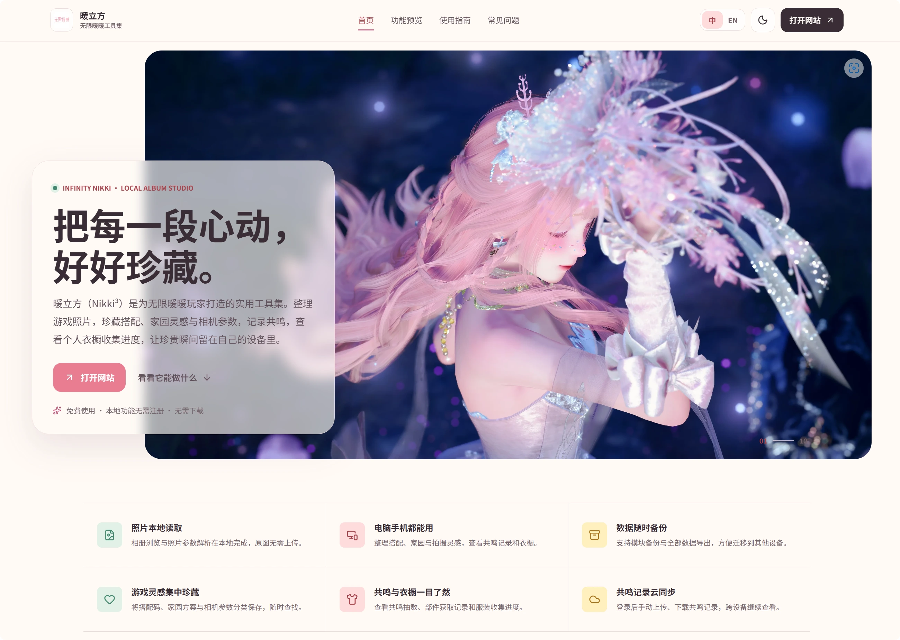
  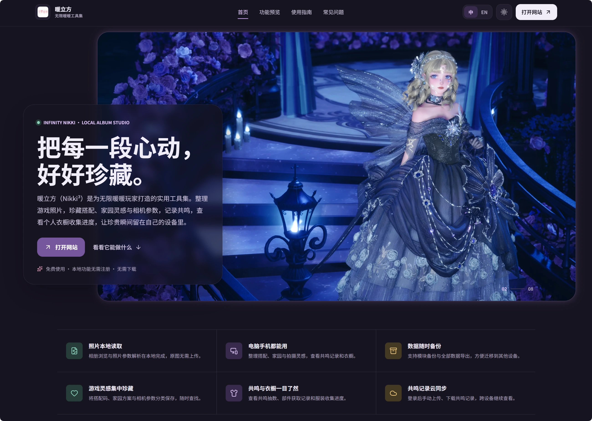
  <p><sub>Left · Official home page in light mode ｜ Right · Dark mode: site overview, feature list, and toolkit entry</sub></p>
</div>

## Mobile

Phones, tablets, and foldable screens adjust their layout to the available width. The screenshots below illustrate the main entries and actions.

### First use and navigation

- Switch between Outfit codes, Home schemes, Camera parameters, and Nikki Archive using bottom navigation.
- Search the current module with the header magnifier; View changes display, theme, and language. Header More provides parsers, lucky draw times, full-data backups, and help.
- “+” adds data, and the page “⋯” menu manages the current module. Use tag or rarity entries to filter. Large previews support swiping, pinch-to-zoom, and panning.
- Use a computer for album folders, automatically reading in-game outfits, and game-file cleanup.

### Outfit codes

Save outfit images and share codes, then copy, edit, or parse them.

<div align="center">
  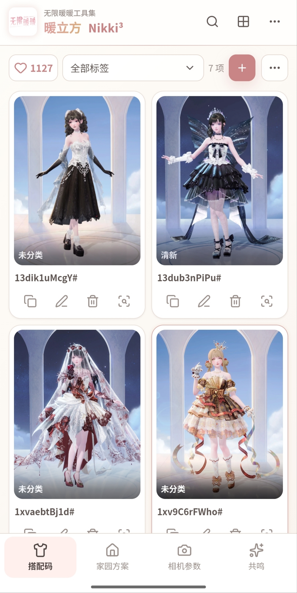
  <p><sub>Outfit list and item details</sub></p>
</div>

- Tap “+” to add an image, code, note, and tag. The code can be left empty and filled in later.
- Card actions provide Copy, Edit, Delete, and Parse. Copy and Parse require a code; double-tap a card for the large preview.
- Use the tag selector to filter or manage tags, and the page “⋯” menu for module ZIP import/export.

### Home schemes and camera parameters

<div align="center">
  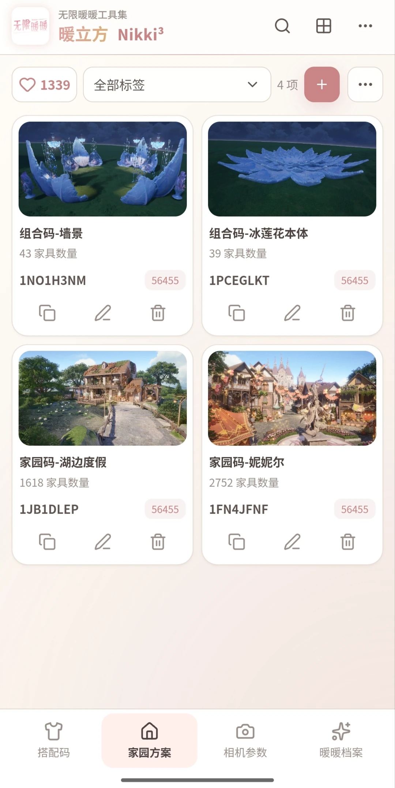
  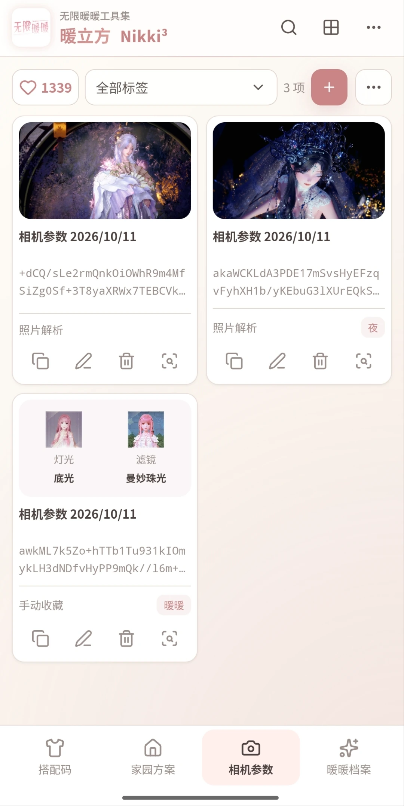
  <p><sub>Left · Home schemes ｜ Right · Camera favorites</sub></p>
</div>

**Home schemes**

- Tap “+”, enter a home code or combo code, then edit the parsed name, cover, notes, and tags before saving.
- Card actions provide Copy, Edit, and Delete. Filter by code type or tag, and double-tap a card for the large preview.

**Camera parameters**

- Tap “+”, parse a parameter code, then enter a name and save. Covers and tags are optional; parameters can also be saved from photo-parsing results.
- Card actions provide Copy, Edit, Delete, and Details. Copied codes can be imported into the in-game camera.

Both collections use the page “⋯” menu for ZIP import/export. Deleting a tag removes its classification without deleting records.

### Nikki Archive

Open Nikki Archive from the bottom navigation, then switch between Resonance records and Personal wardrobe at the top.

<div align="center">
  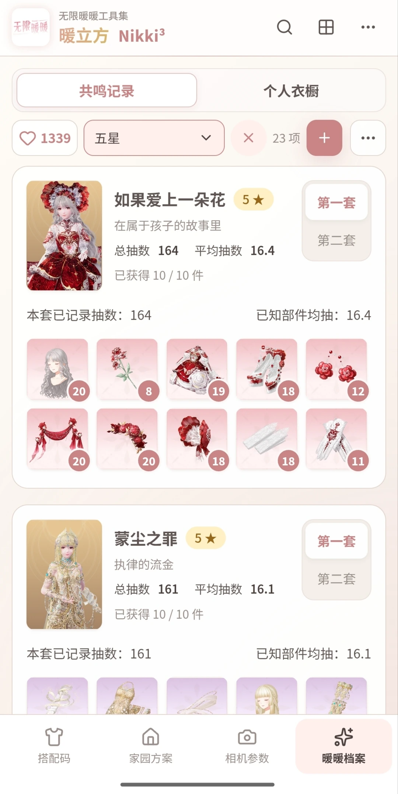
  <p><sub>Resonance: statistics, collection progress, and first/second set switching</sub></p>
</div>

- **Resonance records:** tap “+” to import data, review the preview, then confirm. Use rarity filters to find outfits, and switch between the first and second set on each card.
- For outfits with multiple forms, tap the expand button in the main image’s upper right corner to choose an original, glow-up, or evolution form and view its details. Green checks indicate ownership in your wardrobe data; pull statistics are unchanged.
- The page “⋯” menu provides export, local-record clearing, and account actions. After signing in, manually upload or download cloud records.

<div align="center">
  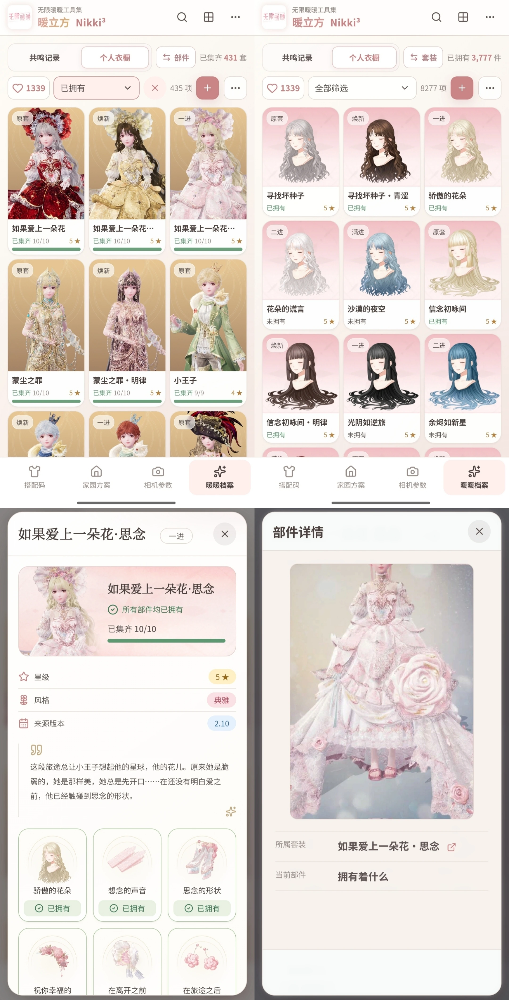
  <p><sub>Personal wardrobe: outfits, pieces, and collection details</sub></p>
</div>

- **Personal wardrobe:** switch between outfits and pieces, search by name or ID, and filter by ownership, rarity, version, and other criteria to inspect collection details.
- Turn on “Show evolution forms” to list forms separately, or turn it off to group each family into one card. Tap the expand icon in a card’s upper right corner and select a form to open its details; forms can also be switched below the detail header.
- Tap “+” to import wardrobe data; use “⋯” to export, clear records or access cloud sync. See [Backup and Migration](#backup-and-migration) for import replacement and cloud-sync rules.

## Desktop

### First use and navigation

Use desktop Chrome, Edge, or a compatible Chromium browser. Switch modules and filter from the sidebar; search the current module from the header. View controls display, theme, and language; Tools opens parsers and utilities; More provides full-data backups and help.

### Albums, photo parameters, and Recently Deleted

Browse game photos by date or action, open large previews, save favorites, and inspect photo parameters.

<div align="center">
  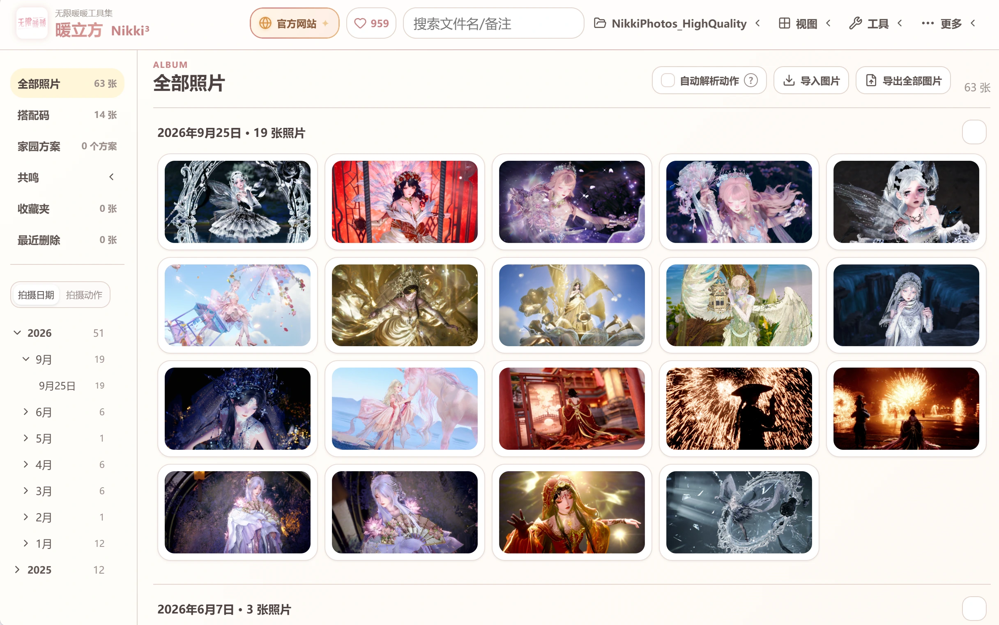
  
  <p><sub>Left · Browse by date ｜ Right · Large preview and photo actions</sub></p>
</div>

Click Choose / restore album folder and select the following directory directly. Avoid drive roots, Program Files, and high-level game installation directories:

```text
...\InfinityNikki Launcher\InfinityNikki\X6Game\Saved\GamePlayPhotos\Your ID\NikkiPhotos_HighQuality
```

#### Compatibility open (read-only)

If normal authorization cannot open your game album, choose **Compatibility open (read-only)** from the current album menu or empty album page, then select the folder directly containing the photos. Files are read locally for this session, without uploading photos or changing the source folder.

- Browse, filter, preview, favorite, parse parameters, and view existing notes. Enter a UID manually to parse parameters without X6Game authorization.
- Only root images are shown; subfolders and `trash` images are excluded. Export downloads ZIP files containing photos and notes, split into parts of at most 128 MiB; individual photos are limited to 64 MiB.
- Importing into the source folder, editing notes, deleting, restoring, and Special Cleanup are unavailable. Switch to normal directory authorization for these actions.
- Use **Select folder again** for new photos. Reloading the page or reopening the site also requires reselection. Canceling, selecting an empty folder, or a read failure preserves the current album. The saved normal directory authorization is retained.
- Favorites use relative paths, sizes, and modification times; identical metadata in same-named folder copies cannot be distinguished. Compatibility and normal mode photo favorites are separate. Original album photos are not persisted in browser storage.

#### Photo controls

| Action | Result |
| --- | --- |
| Single-click photo | Select or unselect |
| Double-click photo | Open large preview |
| Click the heart | Add to or remove from Favorites |
| Click a sidebar date | Jump to that date |
| Left / Right Arrow | Switch photos in large preview |
| Mouse wheel / zoom buttons | Zoom the large preview in 25% steps |
| Drag the large preview | Move the image after zooming in to view details |
| `Esc` | Close the large preview |
| `Delete` | Move the current preview photo to Recently Deleted |
| Bottom action bar | Select all, batch favorite, delete, restore, or permanently delete |
| Import photos | Choose multiple local image files and copy them into the current album |
| Export all photos | Copy every photo to a selected folder with a progress window |
| Selection bar Export | Copy only the selected photos to a selected folder |

> Normal album deletion moves the original file to the current album's `trash` folder; <span style="color: red;">Permanent deletion in Recently Deleted and Special Cleanup directly delete files from your computer and cannot be restored.</span>

#### Recently Deleted and refresh

- Click Refresh album to sync the folder immediately; the page also syncs when it regains focus and reports newly added or externally removed photos.
- Recently Deleted is sorted by deletion time, with total photo count and total size shown at the top; it supports single or batch restore, permanent deletion, select all, large preview, and clearing everything.
- When restoring, if a file with the same name exists in the original album, suffixes like `_restored_1` and `_restored_2` are used automatically without overwriting existing photos.
- Recently Deleted photos do not expire automatically and remain until restored or manually permanently deleted.

### Outfit codes and automatic updates

<div align="center">
  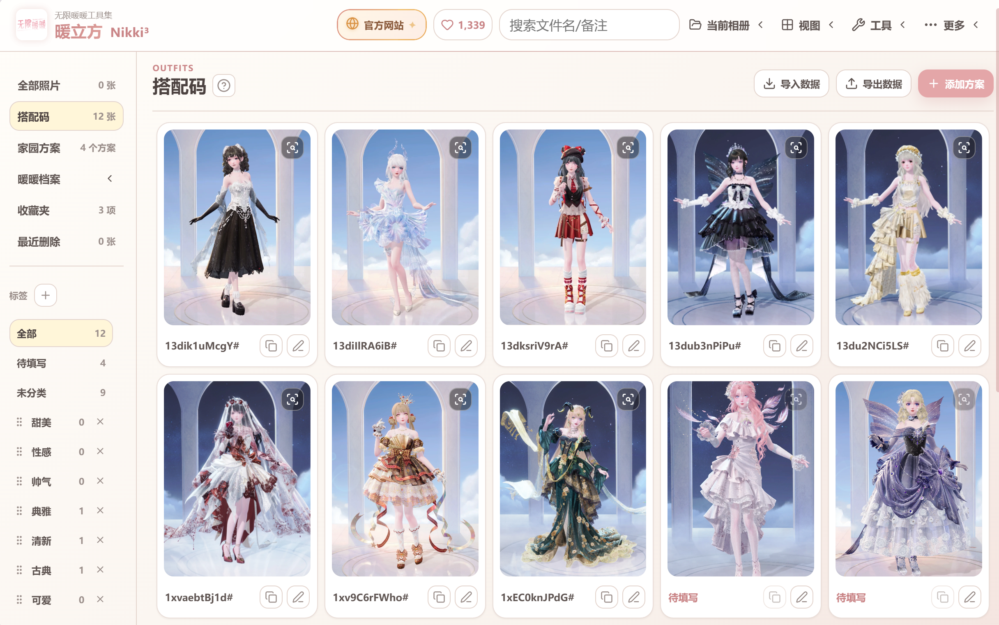
  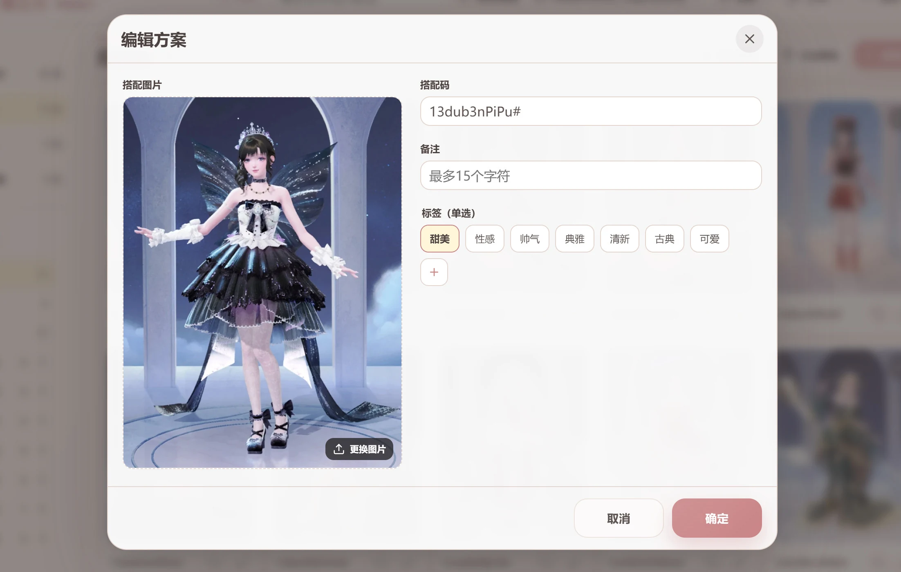
  <p><sub>Left · Outfit plans ｜ Right · Add or edit an outfit</sub></p>
</div>

- Click Add outfit to select, drag, or paste an image and enter a code, notes, and a tag. Codes can be empty. Double-click for a large preview; single-click to select multiple plans and use the bottom action bar.
- Card actions provide Copy, Edit, Delete, and Parse. Manage categories and tag order in the sidebar. Create up to 40 user tags of up to 5 characters each, with one tag per plan.
- View or edit notes in the editor and find them through header search. Selecting an album migrates an old `clothe` collection; check any files reported as skipped before handling them.

#### Automatically update outfit codes

Authorize the game’s `X6Game` folder from Current album. In the game, tap Share, select the screenshot area, generate an outfit code, then return to the website. Import requires a new code and an updated image; duplicates or unchanged or missing images are skipped with a message.

<div align="center">
  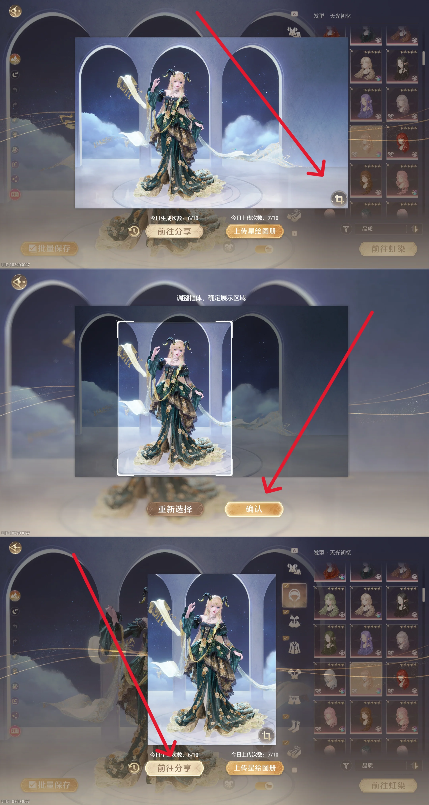
</div>

#### Outfit code parsing

<div align="center">
  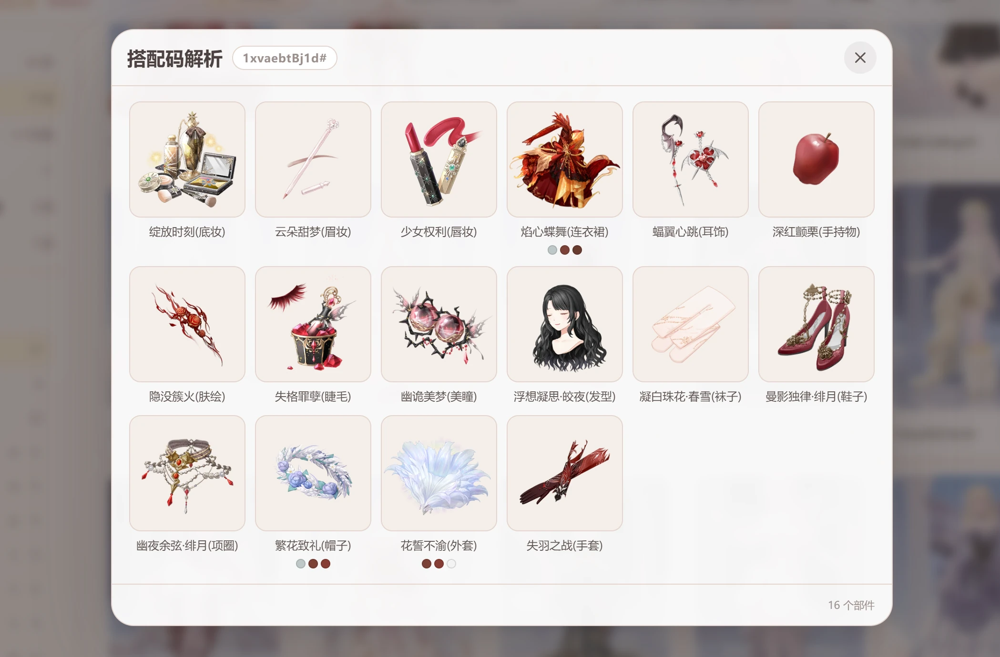
  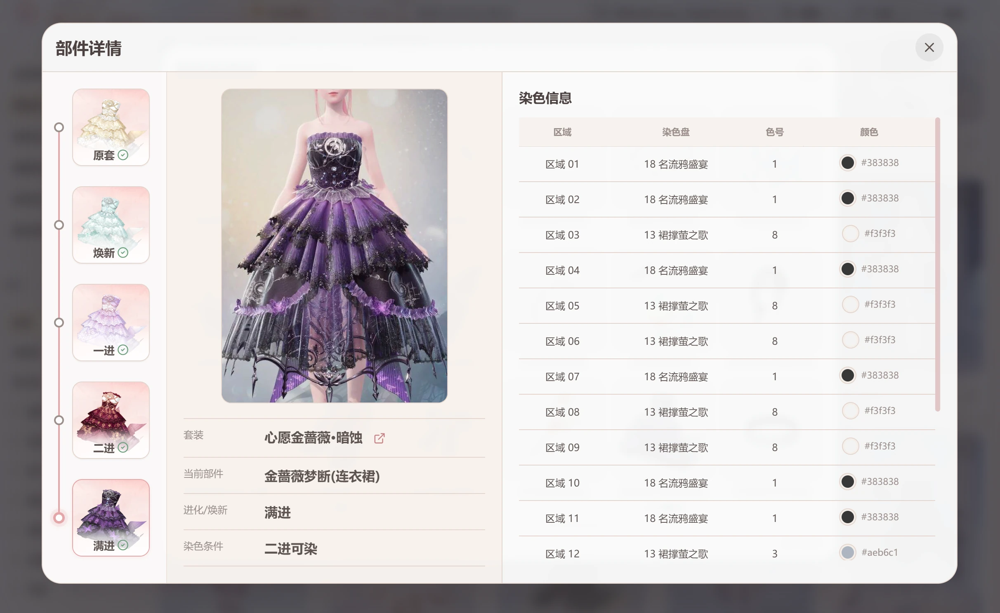
  <p><sub>Left · Outfit pieces and dye overview ｜ Right · Item and dye details</sub></p>
</div>

Use the card’s Parse action, or enter a code directly in Tools → Parameter / outfit-code parser without creating a plan. Copy and Parse are unavailable for plans without a code.

Click a parsed item to view its details. When multiple forms are available, switch between them using the left sidebar on desktop or the row below the title on mobile. Returning to the worn item preserves its outfit-code dyes; other forms show their own details. Owned forms have a green check beside their names.

### Home schemes

<div align="center">
  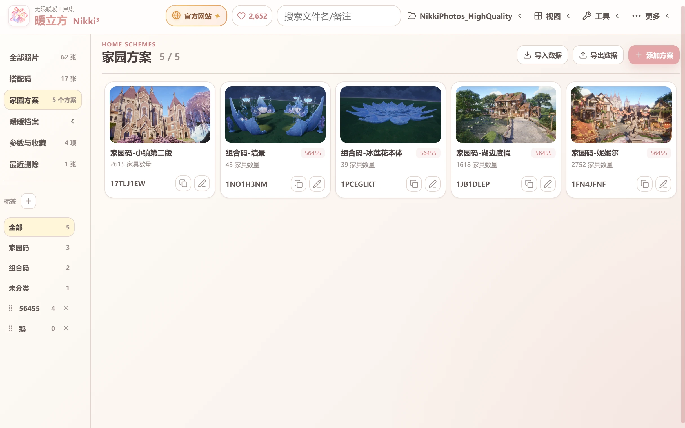
  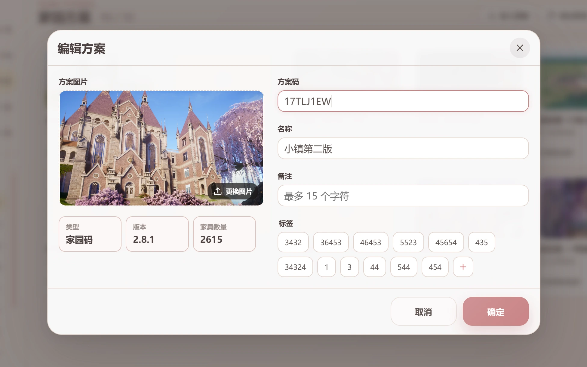
  <p><sub>Left · Home and combo schemes ｜ Right · Scheme editor</sub></p>
</div>

- Click Add scheme, enter a home or combo code, then edit its parsed name, cover, notes, and tags before saving.
- Filter by code type or tag in the sidebar. Card actions provide Copy, Edit, and Delete; double-click for a large preview.
- On desktop, use the view button to the left of Save parameters to switch between stacked and side-by-side layouts when a photo contains outfit data. The initial layout is stacked; subsequent visits restore your last choice. The parameter code spans the bottom in split view. Mobile stays stacked without changing the desktop preference.
- When an original game photo contains outfit data, worn parts and dye swatches appear below its camera parameters. Click a part to view dye details. Standalone camera codes do not contain outfits.
- Page actions provide module ZIP import/export. Deleting a tag does not delete its schemes.

### Camera parameters and favorites

<div align="center">
  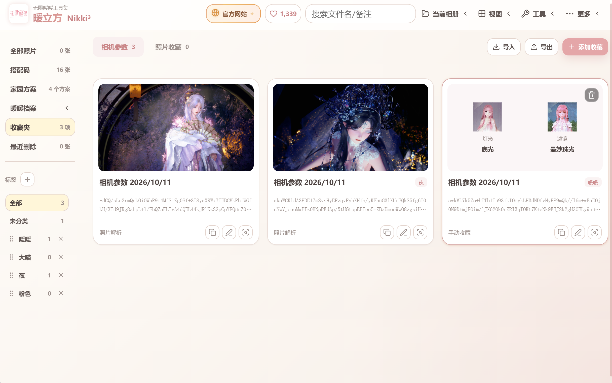
  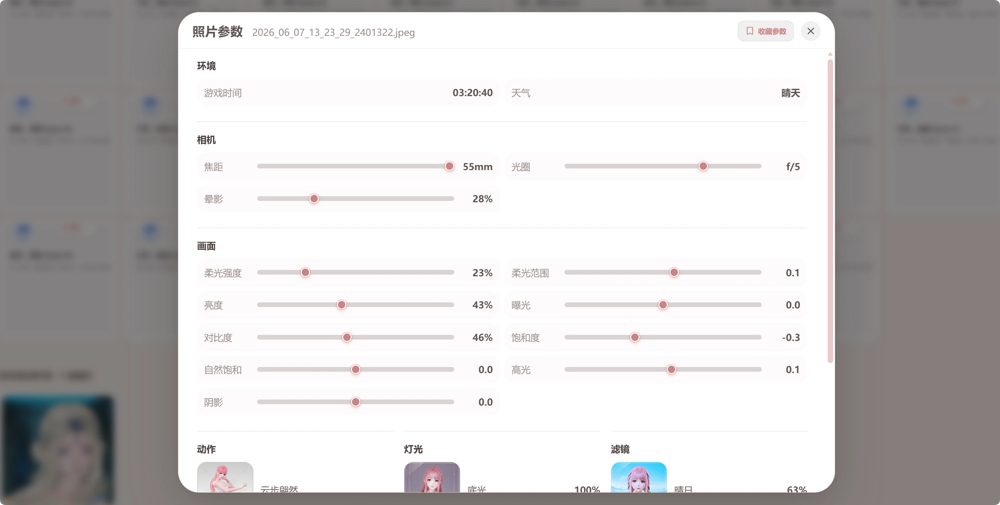
  <p><sub>Left · Camera favorites ｜ Right · Photo parameter parsing</sub></p>
</div>

- Open Favorites → Camera parameters, add and parse a parameter code, then enter a name and save. Covers and tags are optional.
- Parameters can also be saved directly from photo-parsing results. Card actions provide Copy, Edit, Details, and Delete; copied codes can be imported into the in-game camera.
- Page actions provide module ZIP import/export. The parser in Tools also accepts parameter codes or original game photos.

### Nikki Archive

Open Resonance records or Personal wardrobe from Nikki Archive in the sidebar.

<div align="center">
  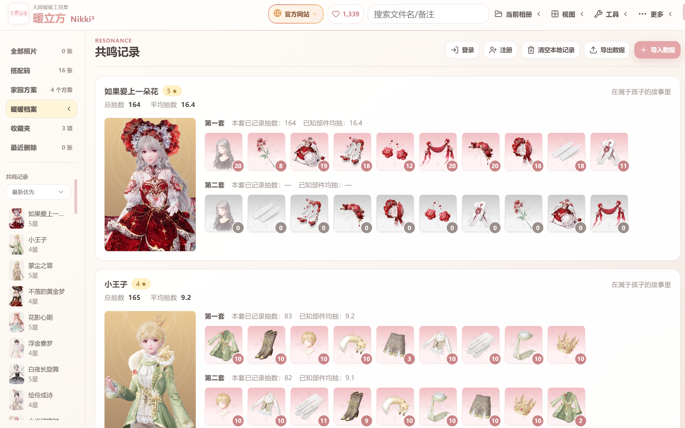
  <p><sub>Resonance: both sets of piece records and pull statistics</sub></p>
</div>

- **Resonance records:** add notebook credentials or JSON data, review the preview, then confirm. Sort, filter rarity, or find an outfit from the sidebar.
- Expand an outfit using the button in its main image’s lower right corner, then select a form to open its details. Only confirmed owned forms receive green checks; records and statistics are unchanged.
- Desktop shows both sets together, with recorded pulls, known-piece averages, and collection progress for each set. The heading shows combined statistics. Manual entries count toward collection progress; unavailable pull statistics show “—”.
- Page actions provide JSON export, local-record clearing, and account cloud sync.

<div align="center">
  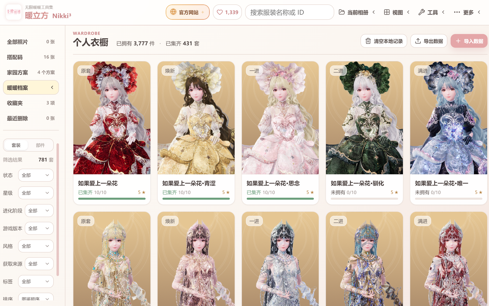
  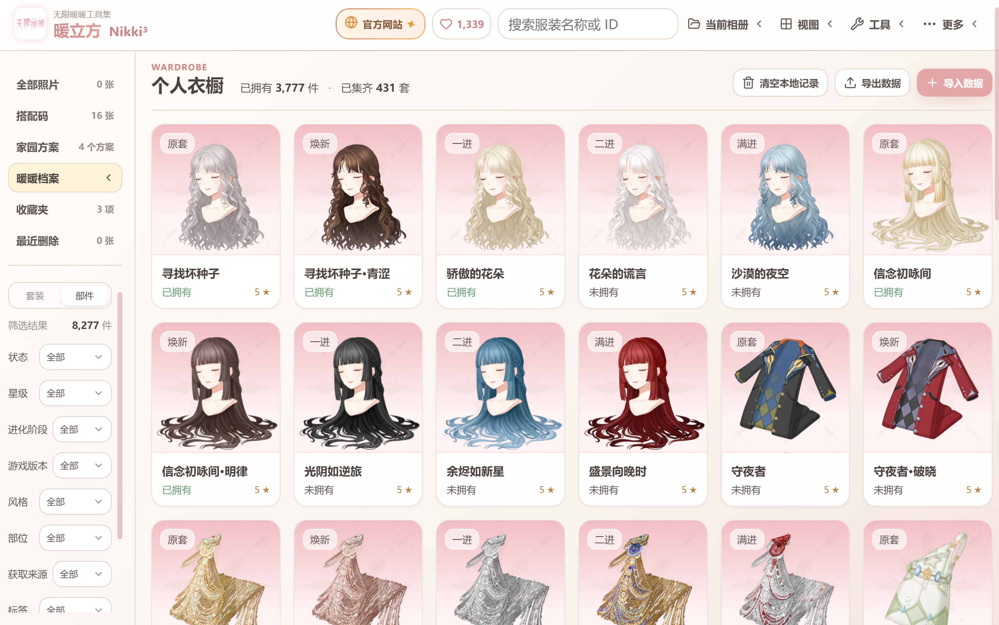
  <p><sub>Left · Outfit collection progress ｜ Right · Pieces and filters</sub></p>
</div>

<div align="center">
  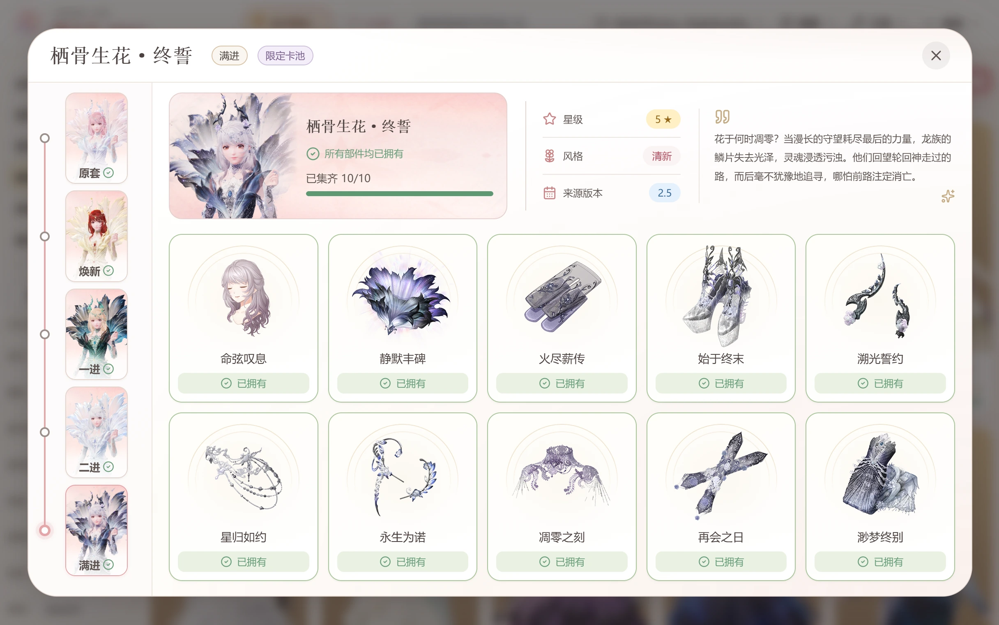
  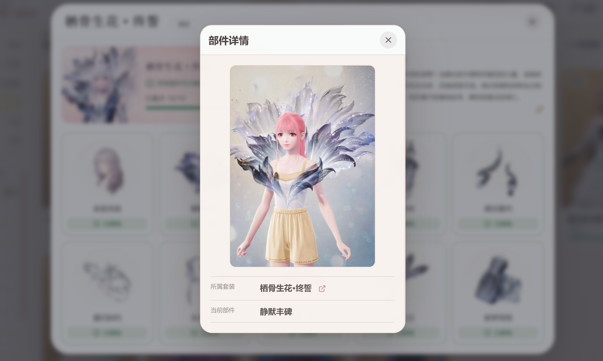
  <p><sub>Personal wardrobe collection details: left · Outfit overview and owned pieces ｜ Right · Item details and associated outfit</sub></p>
</div>

- **Personal wardrobe:** browse original, recolor, and evolution versions. Switch between outfits and pieces, search by name or ID, and filter by rarity, version, item category, or ownership to view details.
- Import a Whim-Log notebook from China or any global server, or wardrobe JSON, and export a separate JSON backup. One notebook preview lets you choose both resonance and wardrobe data. Clearing wardrobe records does not affect resonance. Wardrobe and resonance share an account and one sync dialog, allowing selected modules to upload, download or delete together. Makeup is not supported.
- Check the replacement rules in [Backup and Migration](#backup-and-migration) before importing.

### Cleanup and utilities

<div align="center">
  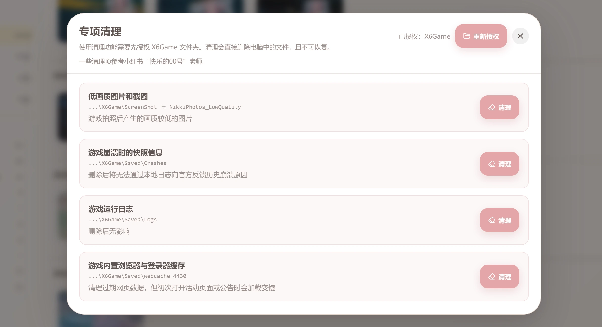
  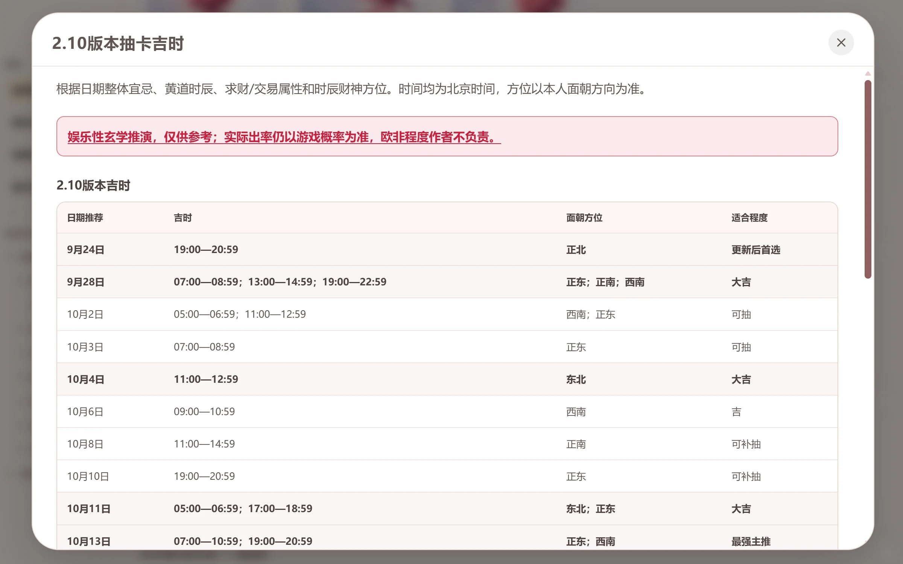
  <p><sub>Left · Special Cleanup ｜ Right · Lucky draw times</sub></p>
</div>

#### Special Cleanup

Open Special Cleanup from the upper-right Tools menu to open the cleanup window. Using the cleanup features requires authorizing the `X6Game` folder.

The following cleanup items are available:

- Low-quality photos and screenshots (`...\X6Game\ScreenShot` and `NikkiPhotos_LowQuality`): lower-quality images produced by in-game photography; only image files are deleted. When multiple account folders exist, you can choose to clean all accounts or a specific account ID. If the album you are currently managing is itself `ScreenShot` or `NikkiPhotos_LowQuality`, the cleanup skips that album folder and only cleans the other one, with a note in the confirmation prompt; managing the `NikkiPhotos_HighQuality` album is recommended.
- Crash snapshots (`...\X6Game\Saved\Crashes`): after deletion, historical crash causes can no longer be reported to the official team via local logs.
- Runtime logs (`...\X6Game\Saved\Logs`): deleting them has no side effects.
- Built-in browser and login cache (`...\X6Game\Saved\webcache_4430`): clears expired web data, but event pages and announcements load more slowly the first time they are opened afterwards.

Open other utilities from Tools. More provides usage help, update notes, and feedback.

## Backup and Migration

From More, choose Export all data to download a ZIP containing outfit plans, home schemes, camera favorites, resonance records, and the wardrobe, including saved scheme images and covers. Transfer the ZIP to another device, then choose Import all data there. **Game album originals are not included; back them up separately.**

Different import entries handle existing records differently:

| Entry | Effect on existing records |
| --- | --- |
| Nikki Archive → Add data | Review the preview, choose the modules, and confirm to replace all records in those modules. Old records absent from the preview are removed. |
| More → Import all data | Merges collections according to each module's rules. Camera-parameter conflicts ask which version to retain; this is not a full replacement. |
| Outfit module → Import data | Adds plans without overwriting existing ones; duplicate or invalid entries are skipped. |

Resonance and wardrobe share one cloud-sync dialog, accessible from either page. Upload and download select available modules by default; you can deselect either module. Cloud deletion requires explicit selection. **Upload replaces the selected cloud modules with their complete local saves; download replaces the selected local modules with their complete cloud saves.** Destination-only records are removed regardless of page filters. Unselected modules remain unchanged. Selected modules commit together: a version conflict or commit failure leaves all selected destinations unchanged. Existing accounts, save formats and module revisions remain compatible. Wardrobe downloads restore the saved region and warn about a region change. A valid imported zero-item wardrobe can sync; an unimported or cleared wardrobe cannot upload, and a missing cloud save never clears local data.

Unrecorded wardrobe pieces were absent from the notebook response; this does not mean they are unowned in the game. A resonance-only export cannot be imported as wardrobe data.

## FAQ

### General questions

#### An image cannot be selected or saved

Try selecting the image again. A failed replacement retains the previous image. Common formats such as WebP, PNG, and JPEG are supported; HEIC/HEIF depends on browser support, so convert it to PNG or JPEG if needed.

#### Photo parameter parsing fails

Use the original game photo. Cropping, compression, or saving it through another app may remove the data needed for parsing. If prompted for a UID, enter the UID of the account that took the photo.

#### Catalog images or details fail to load

Use the retry action where available. If loading still fails, check the network and refresh the page.

### Desktop albums and local startup

#### The launcher does nothing

- Make sure the project has been fully extracted, and do not run it inside the ZIP.
- Make sure Node.js LTS version 22 or newer is installed and the `start` folder is not missing.
- Check whether security software blocked the EXE or BAT file.
- You can also run `start\Start-Remote-D1-Website.bat` directly to view error details.

#### No photos are displayed

- Make sure you selected the actual image folder.
- Make sure the file extension is supported. Photos whose filenames start with a date use that date; other photos use the file's last modified time.
- If browser authorization expires, click Choose / restore album folder again.

#### The browser refuses to open a folder

Browsers block web pages from accessing system folders. Please select `NikkiPhotos_HighQuality` directly, and <span style="color: red;">do not select the drive root or a high-level game install directory.</span>

## Privacy and Safety

- Local photo viewing and photo-parameter parsing happen in your browser; photos and photo-parameter results are not uploaded.
- Outfit-code parsing sends the share code to parsing services, without sending local photos or notebook credentials.
- Cloud sync supports resonance records and the personal wardrobe; select both in one dialog to upload or download them together. Other collections remain in the current browser; back them up before changing devices or clearing site data.
- Clear cache removes parsing caches without deleting saved schemes, tags, or settings. **Clear data permanently removes this browser's saved records, images, favorites, settings, and folder authorizations. Export a backup first.** It does not delete uploaded cloud saves or files on your computer. Clearing data through browser settings may also remove login information.
- Browser security policies may require you to authorize folders again.
- Album deletion and Special Cleanup operate on real files on your computer. Permanent deletion and cleanup cannot be undone.

## Local installation

Requirements: Windows, [Node.js LTS version 22 or newer](https://nodejs.org/), and the latest desktop version of Chrome, Edge, or another compatible Chromium browser.

### Install Node.js

1. Open the [Node.js website](https://nodejs.org/), download the Windows installer for version 22 or newer marked **LTS**, and do not choose the Current version.
2. Run the installer with the default options, and make sure the `Add to PATH` option is not disabled.
3. After installation, close and reopen terminals, project folders, and launcher windows so the environment variables take effect.
4. Press `Win + R`, enter `cmd`, and run:

```bash
node -v
npm -v
```

Both commands should print version numbers, which means installation succeeded. If Windows says the command is not recognized, restart the computer and try again; if it still fails, uninstall Node.js and reinstall the LTS version.

### Local deployment

1. Download and extract the project from [GitHub Releases](https://github.com/sumopenny/Infinity-Nikki-Toolkit/releases) or [Gitee Releases](https://gitee.com/sumopenny/Infinity-Nikki-Toolkit/releases), or clone the source repository.
2. Double-click `网站启动器.exe` in the project root.
3. On first run, dependencies are installed automatically. The browser opens `http://localhost:5173` only after resource updates finish and the dev server successfully starts listening. It does not open during updates or after a startup failure or port conflict; check the dev server window for errors.
4. Keep the window open while using it.

If the launcher is unavailable, run `start\Start-Remote-D1-Website.bat`, or use the commands below. Resource updates require network access; failed updates keep the existing local resources.

The local site connects to the online service for Likes, shared cloud accounts, and resonance/wardrobe cloud sync. These actions affect real online data. The default service is `https://infinity-nikki-album-manager.pages.dev`.

### Development Commands

Run these commands in the project root:

```bash
npm install                # Install dependencies
set REMOTE_API_ORIGIN=https://infinity-nikki-album-manager.pages.dev
npm run dev:remote         # Start locally with the online service
npm test                   # Run automated tests
npm run build              # Type-check and build
npm run build:cloudflare   # Update resources and build for Cloudflare
npm run preview            # Preview the build
```

---

## Acknowledgements and License

Some features were inspired by and use the related services of [Nikki Albums](https://github.com/RanAxro/nikki_albums) and [Gongeo.us Nikki Tracker](https://github.com/dastrokes/gongeo.us-nikki-tracker). Please refer to the root [LICENSE](LICENSE) file for this project's license.
