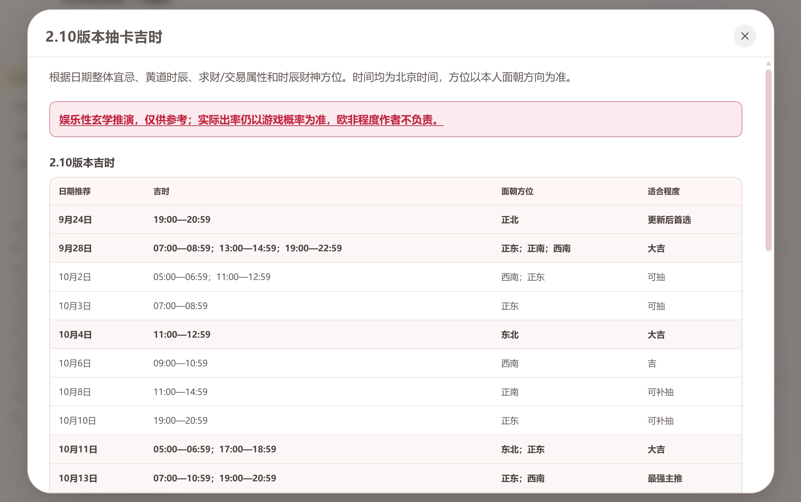

# NikkiCube

<div align="center">
  
  <p><strong>Nikki³ · Infinity Nikki Toolkit</strong></p>
  <p>NikkiCube runs locally in your browser to manage albums, outfit codes, photo parameters, and targeted cleanup.</p>
  <p style="color: orange;">If you run into any issues, please fill out the survey in the site's Feedback section, or report them through GitHub/Gitee Issues or the author's social platforms.</p>
  <p>
    <a href="https://github.com/sumopenny/Infinity-Nikki-Album-Manager/releases">GitHub Releases</a> ·
    <a href="https://gitee.com/sumopenny/Infinity-Nikki-Album-Manager/releases">Gitee Releases</a> ·
    <a href="https://github.com/sumopenny/Infinity-Nikki-Album-Manager">GitHub</a> ·
    <a href="https://gitee.com/sumopenny/Infinity-Nikki-Album-Manager">Gitee</a>
  </p>
  <p><a href="README.md"><strong>简体中文</strong></a></p>
</div>

---
### Official site: https://nikki3.pages.dev/

### Use it online (toolkit): https://infinity-nikki-album-manager.pages.dev/

> Toolkit Vercel fallback (VPN may be required): https://infinity-nikki-album-manager.vercel.app
>
> For local deployment, download the archive or clone the project. Jump to the local deployment guide: [Local Setup for Developers](#local-setup-for-developers)

---
## Website and UI

<div align="center">
  
  <p><sub>Official home page: site overview, feature list, and UI previews, with the entry into the toolkit</sub></p>
</div>

### Browsing the album

<div align="center">
  
  
  <p><sub>Left · Main interface: photo timeline grouped by year / month / day ｜ Right · Large preview: 50%–300% zoom, pan, and keyboard paging</sub></p>
</div>

### Phones and compact windows

- Below 900px, the header keeps the desktop brand presentation, and bottom navigation provides only Outfits, Home schemes, Camera parameters and Resonance. Camera parameters opens the saved parameter collection directly, without the Photo favorites/Camera parameters tabs; desktop keeps the original Favorites tabs. Phones start with Outfits. Album directory access and targeted cleanup require a supported desktop browser.
- The top-right controls are Search (magnifying glass), View and More, in that order. Search applies to the current module through a popover below the header, without changing header height. Clear removes the query; Close keeps the filter, indicated by the themed magnifying glass. Opening View/More or switching modules dismisses the popover; View opens thumbnail, theme and language settings directly, in a window centered in the visible viewport, with a fixed title and close button at the top. Half-size 1:1 is disabled across all modules on phones. Saved half-size preferences display as regular 1:1 on phones while desktop preferences are preserved. Camera parameter favorites and Resonance records use fixed layouts, so all ratio choices are disabled on phones and desktop while theme and language remain available. More contains parsing tools, fortune time, full data backups and help. The More window matches the scheme editor's size and position. Its title and close button stay fixed at the top while the menu below scrolls independently.
- Outfits, Home schemes and Camera favorites combine tags, the result count, Add and backup actions in one row. Add shows only a plus icon; the actions menu shows only an ellipsis icon and contains Import and Export. An active filter can be cleared with one tap. All tags or the current category opens a centered tag picker, without a duplicate Filter button. Search and the two-column list support immediate selection and return to the collection. Manage tags at the bottom provides deletion and sorting through the handle before each tag, without move up/down buttons. The tag picker shows Search and Add tag on the same top row immediately, with Add on the right; management mode hides that entire row and keeps only drag sorting, deletion and Done. Closing the picker keeps the selected filter and resets temporary search and management state. Photo date/action indexes retain their existing filter panels.
- Resonance uses the same single row for rarity, result count, an icon-only Add button and an ellipsis menu with the cloud-sync placeholder, Clear and Export. The rarity entry opens a centered picker with banner ordering, rarity choices and outfit links. Choosing an order or rarity returns immediately to the records; clearing the filter restores all rarities while keeping the order. The row remains available with no records. Desktop keeps its existing layout.
- Cards use two columns on phones and three at 600–899px. On phones and desktop, new tags in all three collections are limited to 5 characters; existing long camera tags and older backups remain usable without truncation. Home scheme tags appear beside the code in one row on phones. Camera parameter tags share a row with Photo parsing/Manual, with the source on the left and the tag on the right. Desktop keeps both tags beside the title. Tags occupy one line and long names are truncated; records containing multiple tags show the first plus the remaining count. Icon-only actions occupy equal-width slots at the bottom: Copy, Edit, Delete and Parse for outfits; Copy, Edit and Delete for home schemes; Copy, Edit, Delete and Details for camera parameters. Icons are 18px in a 44px-high row and do not cover images. Copy and Parse are disabled for outfits without a code; deletion still requires confirmation. Double-click outfit or home cards to preview them. Page menus contain import/export, and empty lists also provide an import entry.
- Batch actions appear above bottom navigation, with select-all, export and related-image cleanup directly available. Existing deletion confirmations remain in place.
- Large previews support horizontal swipes, pinch zoom and panning after zooming. Ending a pinch does not turn the page. The mobile preview toolbar keeps at least 12px of horizontal spacing and 20px corners, with buttons wrapping on narrow screens. Mobile dialogs keep at least 12px of horizontal spacing and 20px corners. Editors keep headers and save actions fixed, scroll the form and adapt to the visible viewport when the keyboard opens.
- To transfer between devices, export a full data ZIP from More on your computer and import it from More on your phone. The empty outfit list also provides a full-data import entry.
- Full-data import/export also works when a phone uses a Network HTTP address shown by the local server. SHA-256 verification automatically uses a fallback implementation without changing the backup format.

## Outfit codes

<div align="center">
  
  
  <p><sub>Left · Outfit codes: plan list, tags, and pending plans ｜ Right · Outfit editor: add an image, enter a code, and pick a tag</sub></p>
</div>

### Parsing and cleanup

<div align="center">
  
  
  <p><sub>Left · Outfit code parsing: item and makeup catalog lookup ｜ Right · Special cleanup: low-quality images, crash snapshots, runtime logs, and the game's built-in browser cache</sub></p>
</div>

### Small tools

<div align="center">
  
  
  <p><sub>Left · Photo parameter parsing: capture time, weather, focal length, aperture, normal poses, lights, and filters ｜ Right · Lucky pull times: the current version table, for entertainment only</sub></p>
</div>


## Features

### Browsing the album

Browse photos grouped by year, month, and date, with thumbnail ratios, a large preview, Favorites, Recently Deleted, batch import/export, and notes and search for photos and outfit plans.

### Outfit codes and parameter parsing

- Store outfit images, codes, and tags locally, with pending plans, automatic image intake, and ZIP import/export; decoded results are cached in the browser by normalized code.
- Enter an outfit code to decode its parts, and click a part to view its outfit, evolution/Glow-Up status, and dye conditions.
- Decode a photo or a CameraParams string to view camera, environment, scene, pose, lighting, and filter parameters, and import the camera parameters into the game in one click; files are read locally in the browser and never uploaded.
- Home schemes: enter a home or combo code to auto-parse the scheme info, with notes, tags, covers, and ZIP backup import/export.

### Resonance records

Import resonance records from the Mainland China Whim-Log or a local JSON file, preview first, then save. View outfit sets and the first/second-set piece pull counts, total pulls and averages per banner, with sorting, rarity filtering, and JSON export.

On phones and desktop, each card shows the outfit and banner names on the same row, with the banner on the right and pull statistics on the next row. Names that exceed the available width use an ellipsis; hover to view the full name.

### File cleanup

Targeted cleanup of low-quality photos and game screenshots, crash snapshots, runtime logs, and the game's built-in browser cache.

### Tools and help

Lucky pull times, Release history, Help and introduction, and issue feedback.

Help and introduction uses one entry with separate Chinese and English content for the current layout. At 900px and above it explains desktop navigation, directory access, mouse controls and shortcuts; compact layouts explain bottom navigation, tag selection, card icons, touch controls and backup migration. Resizing an open help window switches its content. Closing help opened from Release history returns to Release history.

## Quick Start

Official site: https://nikki3.pages.dev/. Open https://infinity-nikki-album-manager.pages.dev/ directly to use the toolkit. You can also download the archive or clone the project to run it locally. Jump to the local deployment guide: [Local Setup for Developers](#local-setup-for-developers).

> If the China-accessible site is temporarily unavailable, try the Vercel fallback (VPN required): https://infinity-nikki-album-manager.vercel.app

## Outfit Code Management
On desktop, entering Outfit codes opens a standalone guide according to your saved preference; the guide button beside the title can also open it. Phones show neither the guide entry nor an automatic guide dialog.
- You can create up to 40 user tags, and each tag can contain up to 5 characters. Deleting a tag in use only moves related plans to Uncategorized.
- New tags appear at the top of the tag list; drag the left handle to adjust the order.
- Click Add outfit to select, drag and drop, or paste an image (click an empty area in the dialog and press `Ctrl+V`). JPG and PNG files are converted locally to WebP, the outfit code can be empty, each plan can use one tag, and double-clicking the image opens the preview.
- The decode button is always visible in the upper-right corner of each outfit card and remains disabled until a code is entered. The delete button sits to its left and appears when the card is hovered or the button receives keyboard focus.
- Click a decoded item image to open its details dialog with the related outfit, outfit image, evolution/glow-up status, and dye conditions. Items with decoded dye data also show the area, palette, color slot, and color. Outfit details load from the public Nikki Tracker API; outfit names, item relations, and dye mappings use the bundled catalog snapshot.
- When a makeup part has no related outfit, the outfit field shows "None" and the left image falls back to the current makeup-part image. Decoded item results remain available if detail loading fails.
- Open the shared Parameter / outfit-code parser from the upper-right Tools menu and enter a code without creating a plan first; results open in the same decoder dialog.
- The outfit preview toolbar shows the current tag and outfit code, with Copy and Edit buttons.
- The app creates a `clothe` folder inside the current album as needed to manage outfit codes. <span style="color: red;">For bulk import, move saved outfit images directly into this folder; opening, refreshing, or refocusing the website page automatically converts them into pending plans.</span>
- If a delete operation cannot fully restore files, the app lists the affected outfits in a dialog; manually inspect the current album's `clothe` folder.
- Using the <span style="color: orange;">auto update outfit code</span> feature requires authorizing the current game's `X6Game` folder. You can authorize it from the Current album menu in the upper-right corner. <span style="color: red;">How to use: in the game, tap Share, tap the selection button at the lower-right corner of the outfit screenshot, tap Generate Outfit Code after the selection is complete, then return to the web page. The website imports only when both the outfit code is new and the game's outfit image has a newer last-modified time; existing codes, unchanged images, or missing images are skipped with a status message.</span>

<div align="center">
  
</div>

- Export data generates a ZIP file in the currently selected album folder and preserves outfit codes, tags, notes, and creation times. Import data validates and merges the ZIP without replacing existing plans; duplicate or invalid content is skipped. Imports validate the complete backup first, then extract and write images in bounded batches to reduce browser memory use with large backups. <span style="color: red;">Deleting an outfit plan is permanent and does not go to Recently Deleted.</span>
- JPG, PNG, and WebP sources are decoded for validation only once before saving. JPG and PNG files are still converted locally to WebP, and images are never uploaded.
- The album supports batch image import through the file picker. The gallery header exports all photos, while the selection bar exports only selected photos. After a successful export, you can choose to move successfully exported source photos to Recently Deleted. Cancelling keeps completed target files and all source photos.
- Single-click outfit plans to select multiple items and show the bottom toolbar. <span style="color: red;">Deleted outfit plans cannot be restored, so check the plan information before confirming.</span>

## Special Cleanup

Open Special Cleanup from the upper-right Tools menu to open the cleanup window. Using the cleanup features requires authorizing the `X6Game` folder.

The following cleanup items are available:

- Low-quality photos and screenshots (`...\X6Game\ScreenShot` and `NikkiPhotos_LowQuality`): lower-quality images produced by in-game photography; only image files are deleted. When multiple account folders exist, you can choose to clean all accounts or a specific account ID. If the album you are currently managing is itself `ScreenShot` or `NikkiPhotos_LowQuality`, the cleanup skips that album folder and only cleans the other one, with a note in the confirmation prompt; managing the `NikkiPhotos_HighQuality` album is recommended.
- Crash snapshots (`...\X6Game\Saved\Crashes`): after deletion, historical crash causes can no longer be reported to the official team via local logs.
- Runtime logs (`...\X6Game\Saved\Logs`): deleting them has no side effects.
- Built-in browser and login cache (`...\X6Game\Saved\webcache_4430`): clears expired web data, but event pages and announcements load more slowly the first time they are opened afterwards.

## Choose an Album

Click `Choose / restore album folder`; it is recommended to select:

```text
...\InfinityNikki Launcher\InfinityNikki\X6Game\Saved\GamePlayPhotos\Your ID\NikkiPhotos_HighQuality
```

Do not select drive roots, Windows, Program Files, the game install root, or other protected or overly broad parent directories.

## Controls

| Action | Result |
| --- | --- |
| Single-click photo | Select or unselect |
| Double-click photo | Open large preview |
| Click the heart | Add to or remove from Favorites |
| Click a sidebar date | Jump to that date |
| Left / Right Arrow | Switch photos in large preview |
| Mouse wheel / zoom buttons | Zoom the large preview in 25% steps |
| Drag the large preview | Move the image after zooming in to view details |
| `Esc` | Close the large preview |
| `Delete` | Move the current preview photo to Recently Deleted |
| Bottom action bar | Select all, batch favorite, delete, restore, or permanently delete |
| Import photos | Choose multiple local image files and copy them into the current album |
| Export all photos | Copy every photo to a selected folder with a progress window |
| Selection bar Export | Copy only the selected photos to a selected folder |

> Normal album deletion moves the original file to the current album's `trash` folder; <span style="color: red;">Permanent deletion in Recently Deleted and Special Cleanup directly delete files from your computer and cannot be restored.</span>

## Recently Deleted and Refresh

- Click Refresh album to sync the folder immediately; the page also syncs when it regains focus and reports newly added or externally removed photos.
- Recently Deleted is sorted by deletion time, with total photo count and total size shown at the top.
- Supports single or batch restore, permanent deletion, select all, large preview, and permanently clearing everything.
- Recently Deleted photos do not expire automatically and remain until restored or manually permanently deleted.


## FAQ

### The launcher does nothing

- Make sure the project has been fully extracted, and do not run it inside the ZIP.
- Make sure Node.js LTS is installed and the `start` folder is not missing.
- Check whether security software blocked the EXE or BAT file.
- You can also run `start\Start-Remote-D1-Website.bat` directly to view error details.

### No photos are displayed

- Make sure you selected the actual image folder.
- Make sure the file extension is supported. Photos whose filenames start with a date use that date; other photos use the file's last modified time.
- If browser authorization expires, click Choose / restore album folder again.

### The browser refuses to open a folder

Browsers block web pages from accessing system folders. Please select `NikkiPhotos_HighQuality` directly, and <span style="color: red;">do not select the drive root or a high-level game install directory.</span>

## Privacy and Safety

- Photos are read locally in your browser.
- Photo-tail extraction, account-key derivation, AES decryption, and CameraParams parsing run locally inside WASM; photos and parsed results are not uploaded.
- Album folder authorization, Favorites, and outfit-code, home-scheme-code, and photo-action parse results are stored locally in the current browser. Clear cache in More clears these three parse caches without affecting other authorizations, settings, saved schemes or tags. After confirmation, Clear data resets preferences and directory authorization while preserving saved schemes, resonance records and favorites. Clearing site data in the browser itself may delete local records; back them up first.
- Browser security policies may require folder authorization again.
- Delete and Special Cleanup modify real files on your computer; Clear cache and Clear data do not delete real photos, `clothe`, `trash`, or other files on your computer.

## Local Setup for Developers

Most users should use the online version first. Download the project only when you need to study the code, customize it, or debug it locally.

Requirements: Windows, [Node.js LTS](https://nodejs.org/), and the latest desktop version of Chrome, Edge, or another compatible Chromium browser.

### Install Node.js

1. Open the [Node.js website](https://nodejs.org/), download the Windows installer marked **LTS**, and do not choose the Current version.
2. Run the installer with the default options, and make sure the `Add to PATH` option is not disabled.
3. After installation, close and reopen terminals, project folders, and launcher windows so the environment variables take effect.
4. Press `Win + R`, enter `cmd`, and run:

```bash
node -v
npm -v
```

Both commands should print version numbers, which means installation succeeded. If Windows says the command is not recognized, restart the computer and try again; if it still fails, uninstall Node.js and reinstall the LTS version.

### Study Code or Run Locally

1. Download and extract the project from [GitHub Releases](https://github.com/sumopenny/Infinity-Nikki-Album-Manager/releases) or [Gitee Releases](https://gitee.com/sumopenny/Infinity-Nikki-Album-Manager/releases), or clone the source repository.
2. Double-click `网站启动器.exe` in the project root.
3. On first run, dependencies are installed automatically and `http://localhost:5173` opens.
4. Keep the window open while using it.

If the launcher is unavailable, double-click `start\Start-Remote-D1-Website.bat`, or use the development commands below to start manually. The root `网站启动器.exe` also uses this remote D1 launcher.

To run the local site against the online D1 data, double-click `start\Start-Remote-D1-Website.bat`. The local server proxies outfit-code data, home-scheme data, and Gongeo catalog details directly to their upstream services; D1 requests such as likes go to the deployed Pages API, so the browser never receives D1 credentials. Production deployments expose same-origin data proxies at `functions/api/gongeo/[[path]].ts` and `functions/api/home-build/[key].ts`. Like actions from this local site write to the online database; use this launcher carefully. The script defaults to `https://infinity-nikki-album-manager.pages.dev`, and accepts another Pages URL as its first argument.

### Development Commands

```bash
npm install       # Install dependencies
npm run dev       # Refresh poses, lights/filters, bilingual item catalogs, and Gongeo mappings before starting the dev server
set REMOTE_API_ORIGIN=https://infinity-nikki-album-manager.pages.dev
npm run dev:remote # Refresh poses, lights/filters, item catalogs, and Gongeo mappings; proxy outfit and home-scheme data to storage and other /api calls to Pages
npm test          # Run automated tests
npm run build     # Type-check and build
npm run build:cloudflare # Refresh normal poses, lights/filters, item catalogs, and Gongeo mappings, then build
npm run resources:update:light-filters # Check light/filter updates separately
npm run preview   # Preview the build result
```

EXE launcher, `dev`, `dev:remote`, and Cloudflare builds share one resource-update chain.

The local EXE launcher, `dev`, `dev:remote`, and Cloudflare builds share the resource update chain. Lights/filters check database and bilingual language-pack versions in Nikki Albums' remote hot-update manifest. Changed versions trigger downloads and validation; only light/filter names, ID mappings, and image templates are replaced, preserving normal poses and Momo data. Matching versions skip resource downloads. Failures print a warning and keep the existing snapshot. Standard `npm run build` only type-checks and builds.

The light/filter script accepts `--force` to refresh, `--strict` to fail on errors, and `--manifest <URL>` / `--timeout <milliseconds>`. Environment overrides are `NUAN5_HOT_UPDATE_MANIFEST` for the remote manifest URL and `NUAN5_HOT_UPDATE_TIMEOUT_MS` for the timeout (15000 milliseconds by default). When passing options through npm, put `--` before them.

Stack: Vue 3, TypeScript, Vite, File System Access API, IndexedDB.

---

## Acknowledgements and License

Some features were inspired by [Nikki Albums](https://github.com/RanAxro/nikki_albums) and [Gongeo.us Nikki Tracker](https://github.com/dastrokes/gongeo.us-nikki-tracker). The bundled Gongeo.us catalog snapshot is distributed under its MIT license; see the root [LICENSE](LICENSE) file for this project's license.
